<!-- TRANG BÌA CHÍNH THỨC -->
<div align="center">

# BỘ GIÁO DỤC VÀ ĐÀO TẠO
## TRƯỜNG ĐẠI HỌC ...
### KHOA CÔNG NGHỆ THÔNG TIN

--------------------------------------------------

### BÁO CÁO ĐỒ ÁN MÔN HỌC
# ĐỀ TÀI:
# XÂY DỰNG WEBSITE THƯƠNG MẠI ĐIỆN TỬ
# THỜI TRANG MAY ĐO CAO CẤP L'ATELIER & CO.

</div>

> **Giảng viên hướng dẫn:** [Điền họ và tên Giảng viên hướng dẫn]
> **Sinh viên thực hiện:**    [Điền họ và tên Sinh viên]
> **Mã số sinh viên:**         [Điền mã số sinh viên]
> **Lớp chuyên ngành:**    [Điền tên lớp]
> **Ngành học:**                 Công nghệ Thông tin / Kỹ thuật Phần mềm
> **Khóa học:**                   2022 - 2026
> **Năm học:**                     2026

<div align="center">HÀ NỘI / TP. HỒ CHÍ MINH - NĂM 2026</div>


\pagebreak

# LỜI CẢM ƠN

Lời đầu tiên, em xin gửi lời cảm ơn chân thành và sâu sắc nhất tới toàn thể quý Thầy, Cô giáo khoa Công nghệ Thông tin đã tận tình giảng dạy, truyền đạt những kiến thức chuyên môn quý báu, nền tảng tư duy khoa học và các kỹ năng lập trình phần mềm thực tiễn trong suốt quá trình em học tập tại nhà trường. Những bài giảng tâm huyết của quý Thầy, Cô chính là hành trang quan trọng và nền tảng cốt lõi giúp em có thể nghiên cứu, hiện thực hóa và hoàn thành tốt đồ án môn học này.

Đặc biệt, em xin bày tỏ lòng biết ơn sâu sắc tới Giảng viên hướng dẫn môn học, người đã luôn dành thời gian tận tâm định hướng, theo sát tiến độ, chỉ bảo phương pháp nghiên cứu và đưa ra những lời khuyên, nhận xét chuyên môn vô cùng quý báu trong suốt các giai đoạn khảo sát, phân tích yêu cầu nghiệp vụ, thiết kế kiến trúc hệ thống và giải quyết các vấn đề kỹ thuật phát sinh trong quá trình xây dựng website.

Mặc dù bản thân đã rất nỗ lực, nghiêm túc đầu tư thời gian và áp dụng các công nghệ hiện đại nhất (Spring Boot 3, Java 21, React 19, TypeScript, MySQL 8.0, VNPay Sandbox) để hoàn thiện một sản phẩm thương mại điện tử chuyên nghiệp theo tiêu chuẩn cao cấp, song do kiến thức và kinh nghiệm thực tiễn chưa thể toàn diện, đồ án khó tránh khỏi những hạn chế và thiếu sót nhất định. Em rất kính mong nhận được những ý kiến đóng góp, chỉ bảo và nhận xét quý báu từ quý Thầy, Cô để hệ thống của em ngày càng hoàn thiện, ổn định và có tính ứng dụng thực tiễn cao hơn trong tương lai.

Em xin chân thành cảm ơn!

<div align="right">
*Sinh viên thực hiện*
*(Ký và ghi rõ họ tên)*
</div>


\pagebreak

# MỤC LỤC

- **LỜI CẢM ƠN**
- **MỤC LỤC**
- **DANH MỤC CÁC CHỮ VIẾT TẮT**
- **DANH MỤC CÁC BẢNG**
- **DANH MỤC CÁC HÌNH**
- **MỞ ĐẦU**
  - 1. Lý do chọn đề tài
  - 2. Mục tiêu đề tài
  - 3. Đối tượng và phạm vi nghiên cứu
  - 4. Phương pháp nghiên cứu và cấu trúc báo cáo
- **CHƯƠNG 1: TỔNG QUAN VỀ CÔNG NGHỆ VÀ HỆ THỐNG**
  - 1.1 Tổng quan về bài toán thương mại điện tử ngành thời trang may đo cao cấp
  - 1.2 Kiến trúc hệ thống Client - Server và mô hình RESTful API
  - 1.3 Công nghệ phát triển phía Backend (Spring Boot 3 & Java 21)
    - 1.3.1 Ngôn ngữ Java 21 LTS
    - 1.3.2 Framework Spring Boot 3.4.3
    - 1.3.3 Bảo mật phiên làm việc với Spring Security và JSON Web Token (JWT)
    - 1.3.4 Tầng lưu trữ và truy xuất dữ liệu với Spring Data JPA và Hibernate ORM
    - 1.3.5 Hệ quản trị cơ sở dữ liệu quan hệ MySQL 8.0 chuẩn utf8mb4
  - 1.4 Công nghệ phát triển phía Frontend (React 19, TypeScript, Vite)
    - 1.4.1 Thư viện React 19 và ngôn ngữ TypeScript
    - 1.4.2 Công cụ đóng gói và máy chủ phát triển Vite
    - 1.4.3 Hệ thống thiết kế Vanilla CSS Modern Minimalist Luxury
    - 1.4.4 Nghệ thuật chữ Typography (Playfair Display & Be Vietnam Pro)
    - 1.4.5 Thư viện biểu tượng Lucide React
  - 1.5 Tích hợp cổng thanh toán trực tuyến mô phỏng (VNPay Gateway Sandbox)
  - 1.6 Môi trường phát triển, biên dịch và công cụ kiểm thử
- **CHƯƠNG 2: PHÂN TÍCH VÀ THIẾT KẾ HỆ THỐNG**
  - 2.1 Mô tả bài toán
    - 2.1.1 Bối cảnh và mục tiêu nghiệp vụ
    - 2.1.2 Quy trình nghiệp vụ khách hàng (Customer Journey)
    - 2.1.3 Quy trình nghiệp vụ quản trị viên (Admin Operations)
  - 2.2 Yêu cầu bài toán
    - 2.2.1 Yêu cầu chức năng
    - 2.2.2 Yêu cầu phi chức năng
  - 2.3 Phân tích tác nhân hệ thống (Actors)
  - 2.4 Biểu đồ Use Case
    - 2.4.1 Biểu đồ Use Case tổng quát
    - 2.4.2 Biểu đồ Use Case phía Quản trị viên (Admin)
    - 2.4.3 Biểu đồ Use Case phía Người dùng (Khách hàng)
  - 2.5 Mô tả chi tiết các Use Case chính
    - 2.5.1 Use case Đăng ký và Đăng nhập hệ thống (UC_01)
    - 2.5.2 Use case Xem chi tiết và Lựa chọn biến thể sản phẩm (UC_02)
    - 2.5.3 Use case Quản lý giỏ hàng mua sắm (UC_03)
    - 2.5.4 Use case Đặt hàng và Thanh toán trực tuyến VNPay (UC_04)
    - 2.5.5 Use case Quản lý đơn hàng phía Quản trị viên (UC_05)
    - 2.5.6 Use case Thêm mới sản phẩm và biến thể tồn kho (UC_06)
    - 2.5.7 Use case Xem thống kê Dashboard phân tích kinh doanh (UC_07)
  - 2.6 Thiết kế Backend
    - 2.6.1 Thiết kế biểu đồ mô tả các chức năng (Sequence Diagram & VOPC Class Diagram)
      - 2.6.1.1 Chức năng Đăng nhập hệ thống (Biểu đồ trình tự & Lớp VOPC)
      - 2.6.1.2 Chức năng Đặt hàng và Thanh toán trực tuyến VNPay (Biểu đồ trình tự & Lớp VOPC)
      - 2.6.1.3 Chức năng Thêm mới sản phẩm quản trị (Biểu đồ trình tự & Lớp VOPC)
    - 2.6.2 Biểu đồ lớp tổng thể (Overall Class Diagram)
    - 2.6.3 Thiết kế Cơ sở dữ liệu quan hệ (ERD và Data Dictionary 14 bảng)
- **CHƯƠNG 3: CHƯƠNG TRÌNH THỬ NGHIỆM VÀ KẾT QUẢ**
  - 3.1 Môi trường triển khai và cấu hình vận hành hệ thống
  - 3.2 Giao diện và kết quả thử nghiệm phía Người dùng (Khách hàng)
  - 3.3 Giao diện và kết quả thử nghiệm phía Quản trị viên (Admin Portal)
  - 3.4 Kịch bản kiểm thử các ca kiểm thử chính (Test Cases)
  - 3.5 Đánh giá ưu điểm và hạn chế của hệ thống
- **KẾT LUẬN VÀ HƯỚNG PHÁT TRIỂN**
- **TÀI LIỆU THAM KHẢO**


\pagebreak

# DANH MỤC CÁC CHỮ VIẾT TẮT

<div align="center">

*Bảng 0.1*. Danh mục các chữ viết tắt sử dụng trong đồ án

</div>

| STT | Ký hiệu viết tắt | Thuật ngữ tiếng Anh đầy đủ | Ý nghĩa / Giải thích tiếng Việt |
|:---:|:---|:---|:---|
| 1 | **API** | Application Programming Interface | Giao diện lập trình ứng dụng |
| 2 | **REST** | Representational State Transfer | Kiểu kiến trúc truyền trạng thái đại diện cho dịch vụ web |
| 3 | **JWT** | JSON Web Token | Chuẩn mã thông báo định danh an toàn định dạng JSON (RFC 7519) |
| 4 | **ORM** | Object-Relational Mapping | Kỹ thuật ánh xạ quan hệ đối tượng cơ sở dữ liệu |
| 5 | **JPA** | Jakarta Persistence API | Bộ đặc tả tiêu chuẩn cho quản trị dữ liệu quan hệ trong Java |
| 6 | **DTO** | Data Transfer Object | Đối tượng vận chuyển dữ liệu giữa các tầng kiến trúc |
| 7 | **BCE** | Boundary - Control - Entity | Mô hình phân tích kiến trúc đối tượng phần mềm (RUP/UML) |
| 8 | **VOPC** | View - Operation - Process - Control | Biểu đồ lớp cộng tác tham gia hiện thực hóa ca sử dụng |
| 9 | **UI/UX** | User Interface / User Experience | Giao diện người dùng / Trải nghiệm người dùng |
| 10 | **SPA** | Single Page Application | Ứng dụng web trang đơn tải động không nạp lại trang |
| 11 | **HMR** | Hot Module Replacement | Cơ chế thay thế và cập nhật mô-đun mã nguồn tức thì trong Vite |
| 12 | **SKU** | Stock Keeping Unit | Đơn vị và mã quản lý hàng hóa phân loại lưu kho |
| 13 | **ERD** | Entity Relationship Diagram | Biểu đồ quan hệ thực thể trong cơ sở dữ liệu quan hệ |
| 14 | **CRUD** | Create, Read, Update, Delete | Bốn thao tác dữ liệu cơ bản: Tạo mới, Đọc, Cập nhật, Xóa |
| 15 | **RDBMS** | Relational Database Management System | Hệ quản trị cơ sở dữ liệu quan hệ (như MySQL, PostgreSQL) |
| 16 | **COD** | Cash On Delivery | Phương thức thanh toán tiền mặt trực tiếp khi nhận hàng |
| 17 | **ACID** | Atomicity, Consistency, Isolation, Durability | Bốn thuộc tính toàn vẹn bắt buộc của giao dịch cơ sở dữ liệu |

\pagebreak

# DANH MỤC CÁC BẢNG VÀ HÌNH

### 1. Danh mục các bảng biểu

- *Bảng 0.1*: Danh mục các chữ viết tắt sử dụng trong đồ án
- *Bảng 2.1*: Mô tả chi tiết Use case Đăng ký và Đăng nhập hệ thống (`UC_01`)
- *Bảng 2.2*: Mô tả chi tiết Use case Xem chi tiết và Lựa chọn biến thể sản phẩm (`UC_02`)
- *Bảng 2.3*: Mô tả chi tiết Use case Quản lý giỏ hàng mua sắm (`UC_03`)
- *Bảng 2.4*: Mô tả chi tiết Use case Đặt hàng và Thanh toán trực tuyến VNPay (`UC_04`)
- *Bảng 2.5*: Mô tả chi tiết Use case Quản lý đơn hàng phía Quản trị viên (`UC_05`)
- *Bảng 2.6*: Mô tả chi tiết Use case Thêm mới sản phẩm và biến thể tồn kho (`UC_06`)
- *Bảng 2.7*: Mô tả chi tiết Use case Xem thống kê Dashboard phân tích kinh doanh (`UC_07`)
- *Bảng 2.8*: Cấu trúc bảng lưu trữ thông tin Người dùng (`users`)
- *Bảng 2.9*: Cấu trúc bảng lưu trữ Danh mục thời trang (`categories`)
- *Bảng 2.10*: Cấu trúc bảng lưu trữ Thương hiệu may đo (`brands`)
- *Bảng 2.11*: Cấu trúc bảng lưu trữ Thông tin sản phẩm gốc (`products`)
- *Bảng 2.12*: Cấu trúc bảng lưu trữ Biến thể sản phẩm (`product_variants`)
- *Bảng 2.13*: Cấu trúc bảng lưu trữ Thư viện ảnh sản phẩm theo màu (`product_images`)
- *Bảng 2.14*: Cấu trúc bảng lưu trữ Giỏ hàng người dùng và giỏ ẩn danh (`carts`)
- *Bảng 2.15*: Cấu trúc bảng lưu trữ Chi tiết mặt hàng trong giỏ (`cart_items`)
- *Bảng 2.16*: Cấu trúc bảng lưu trữ Đơn đặt hàng (`orders`)
- *Bảng 2.17*: Cấu trúc bảng lưu trữ Chi tiết sản phẩm trong đơn hàng (`order_items`)
- *Bảng 2.18*: Cấu trúc bảng lưu trữ Mã giảm giá khuyến mãi (`coupons`)
- *Bảng 2.19*: Cấu trúc bảng lưu trữ Nhận xét và đánh giá khách hàng (`reviews`)
- *Bảng 2.20*: Cấu trúc bảng lưu trữ Sổ địa chỉ giao hàng (`addresses`)
- *Bảng 2.21*: Cấu trúc bảng lưu trữ Giao dịch thanh toán trực tuyến (`payments`)
- *Bảng 3.1*: Ca kiểm thử chức năng Đăng ký, Đăng nhập và Phân quyền JWT (`TC_AUTH`)
- *Bảng 3.2*: Ca kiểm thử chức năng Giỏ hàng, Cập nhật số lượng và Tạm tính (`TC_CART`)
- *Bảng 3.3*: Ca kiểm thử chức năng Áp dụng Coupon và Tạo đơn hàng (`TC_ORDER`)
- *Bảng 3.4*: Ca kiểm thử chức năng Thanh toán trực tuyến qua VNPay Gateway (`TC_PAY`)
- *Bảng 3.5*: Ca kiểm thử chức năng Quản trị: Thêm mới sản phẩm và Đổi trạng thái (`TC_ADMIN`)

### 2. Danh mục các hình ảnh và biểu đồ

- *Hình 1.1*: Sơ đồ kiến trúc phân tầng hệ thống Client - Server qua RESTful API
- *Hình 2.1*: Biểu đồ Use Case tổng quát toàn bộ hệ thống L'ATELIER & CO.
- *Hình 2.2*: Biểu đồ Use Case phân rã chức năng phía Quản trị viên (Admin)
- *Hình 2.3*: Biểu đồ Use Case phân rã chức năng phía Khách hàng (Customer)
- *Hình 2.4*: Mô hình hóa Use case Đăng ký và Đăng nhập hệ thống (`UC_01`)
- *Hình 2.5*: Mô hình hóa Use case Xem chi tiết và Lựa chọn biến thể sản phẩm (`UC_02`)
- *Hình 2.6*: Mô hình hóa Use case Quản lý giỏ hàng mua sắm (`UC_03`)
- *Hình 2.7*: Mô hình hóa Use case Đặt hàng và Thanh toán trực tuyến VNPay (`UC_04`)
- *Hình 2.8*: Mô hình hóa Use case Quản lý đơn hàng phía Quản trị viên (`UC_05`)
- *Hình 2.9*: Mô hình hóa Use case Thêm mới sản phẩm và cấu hình biến thể (`UC_06`)
- *Hình 2.10*: Mô hình hóa Use case Báo cáo thống kê Dashboard (`UC_07`)
- *Hình 2.11*: Biểu đồ trình tự (Sequence Diagram) chức năng Đăng nhập hệ thống chuẩn BCE
- *Hình 2.12*: Biểu đồ trình tự (Sequence Diagram) chức năng Đặt hàng và Thanh toán VNPay
- *Hình 2.13*: Biểu đồ trình tự (Sequence Diagram) chức năng Thêm mới sản phẩm quản trị
- *Hình 2.14*: Biểu đồ lớp phân tích VOPC cho ca sử dụng Đặt hàng và Thanh toán
- *Hình 2.15*: Biểu đồ lớp phân tích VOPC cho ca sử dụng Quản trị sản phẩm
- *Hình 2.16*: Biểu đồ lớp tổng thể (Overall Class Diagram) hệ thống Backend
- *Hình 2.17*: Biểu đồ quan hệ thực thể (Entity Relationship Diagram - ERD) cơ sở dữ liệu
- *Hình 3.1*: Giao diện Trang chủ và Khối giới thiệu Bộ sưu tập Capsule (Home Banner)
- *Hình 3.2*: Giao diện Cửa hàng sản phẩm kèm Bộ lọc danh mục, mức giá và tìm kiếm
- *Hình 3.3*: Giao diện Trang Chi tiết sản phẩm với lựa chọn tương tác Màu sắc & Size
- *Hình 3.4*: Giao diện Túi mua sắm trượt (Cart Drawer) và tính năng cập nhật số lượng
- *Hình 3.5*: Giao diện Trang Đặt hàng (Checkout) và cơ chế Áp dụng mã giảm giá
- *Hình 3.6*: Giao diện Mô phỏng Cổng thanh toán trực tuyến bảo mật VNPay Sandbox
- *Hình 3.7*: Giao diện Trang Xác nhận đơn hàng thành công (Order Confirmation)
- *Hình 3.8*: Giao diện Trang Lịch sử đơn hàng của tôi (My Orders)
- *Hình 3.9*: Giao diện Bảng điều khiển Quản trị viên (Dashboard KPI Analytics)
- *Hình 3.10*: Giao diện Quản lý Đơn hàng và Cập nhật trạng thái giao hàng
- *Hình 3.11*: Giao diện Quản lý Danh sách Sản phẩm, Tồn kho và Modal Thêm thiết kế mới
- *Hình 3.12*: Giao diện Quản lý Danh sách Khách hàng trong hệ thống

\pagebreak

# MỞ ĐẦU

## 1. Lý do chọn đề tài

Trong thời đại công nghệ số 4.0, sự phát triển vượt bậc của Internet và các thiết bị di động thông minh đã biến thương mại điện tử (E-Commerce) trở thành một kênh giao thương chủ đạo, thay đổi căn bản hành vi mua sắm của người tiêu dùng trên toàn cầu cũng như tại Việt Nam. Người mua ngày nay không chỉ tìm kiếm sự tiện lợi trong thanh toán và giao hàng, mà còn đặt ra những đòi hỏi khắt khe về trải nghiệm thị giác, tính cá nhân hóa và sự thấu cảm trong thiết kế giao diện.

Đặc biệt, đối với ngành thời trang thiết kế may đo cao cấp (Haute Couture và Contemporary Tailoring), sản phẩm mang hàm lượng nghệ thuật và giá trị thủ công cao. Việc bán các sản phẩm cao cấp này (như Áo Blazer dạ Cashmere, Đầm lụa tơ tằm dâu tằm, Sơ mi Poplin bông Supima, Áo khoác Măng tô Gabardine) trên các sàn thương mại điện tử đại trà thường gặp phải nhiều rào cản lớn: giao diện bị gò bó, không làm nổi bật được vẻ đẹp phom dáng và chất liệu vải, quy trình chọn lựa biến thể màu sắc và kích cỡ thiếu trực quan, đồng thời không truyền tải được câu chuyện thương hiệu xa xỉ và tinh thần độc bản của nhà may.

Từ thực tiễn đó, đề tài **'Xây dựng website thương mại điện tử thời trang may đo cao cấp L'ATELIER & CO.'** được lựa chọn nghiên cứu và thực hiện. Đồ án giải quyết trọn vẹn bài toán xây dựng một nền tảng web thương mại điện tử chuyên nghiệp, ứng dụng mô hình kiến trúc phân tầng độc lập Client - Server hiện đại với Backend xây dựng trên Spring Boot 3 / Java 21, Frontend xây dựng trên React 19 / TypeScript / Vite, kết hợp ngôn ngữ thiết kế Hiện đại - Tối giản sang trọng (Modern Minimalist Luxury) và cổng thanh toán trực tuyến VNPay, nhằm mang đến cho khách hàng một không gian mua sắm thời trang đẳng cấp, mượt mà và an toàn.

## 2. Mục tiêu đề tài

Đồ án hướng tới việc hoàn thành đầy đủ các mục tiêu cốt lõi sau:

1. **Về mặt kiến trúc phần mềm:** Hiện thực hóa kiến trúc Client - Server phân tách hoàn toàn qua hệ thống giao diện lập trình ứng dụng RESTful API không trạng thái (Stateless API), đảm bảo khả năng mở rộng linh hoạt, độc lập triển khai và dễ dàng tích hợp đa nền tảng.

2. **Về mặt Backend & Cơ sở dữ liệu:**

   - Sử dụng ngôn ngữ **Java 21 LTS** và framework **Spring Boot 3.4.3** để xây dựng máy chủ xử lý logic nghiệp vụ an toàn, ổn định.

   - Ứng dụng **Spring Security** kết hợp chuẩn mã thông báo **JSON Web Token (JWT)** và mã hóa mật khẩu một chiều **BCrypt** để bảo mật toàn diện danh tính người dùng và phân quyền tác vụ (ROLE_CUSTOMER, ROLE_ADMIN).

   - Quản trị cơ sở dữ liệu quan hệ **MySQL 8.0** thông qua **Spring Data JPA** và **Hibernate ORM 6.6**; bảo đảm 100% dữ liệu được lưu trữ chuẩn bảng mã quốc tế `utf8mb4_unicode_ci` không lỗi font tiếng Việt.

3. **Về mặt Frontend & Trải nghiệm người dùng:**

   - Xây dựng ứng dụng trang đơn (Single Page Application - SPA) với **React 19**, **TypeScript** và công cụ đóng gói tối tân **Vite**.

   - Xây dựng hệ thống thiết kế riêng biệt (**Vanilla CSS Design System**) theo phong cách xa xỉ tối giản: bảng màu chọn lọc (Vàng Champagne `#C5A880`, Đen than `#0E0E10`, Trắng ngà `#FAF9F6`), hiệu ứng kính mờ (Glassmorphism backdrop-filter) và tích hợp hai bộ font chuẩn quốc tế: **Playfair Display** (serif thời trang sang trọng) và **Be Vietnam Pro** (sans-serif tối ưu tuyệt đối cho tiếng Việt).

4. **Về mặt nghiệp vụ thương mại:**

   - Hiện thực hóa đầy đủ quy trình mua sắm thời trang: duyệt bộ sưu tập, lọc đa tiêu chí (danh mục, mức giá, thương hiệu), xem chi tiết tương tác đổi ảnh theo màu sắc, quản lý giỏ hàng tức thì (Cart Drawer), áp dụng mã giảm giá Coupon.

   - Tích hợp mô phỏng Cổng thanh toán trực tuyến **VNPay Gateway Sandbox**, cho phép xác nhận thanh toán điện tử an toàn và cập nhật trạng thái đơn hàng tự động.

5. **Về mặt quản trị hệ thống (Admin Portal):**

   - Cung cấp Bảng điều khiển (Dashboard) trực quan phân tích 5 chỉ số tài chính KPI then chốt (Tổng doanh thu, Tổng đơn hàng, Đơn chờ xử lý, Tổng thiết kế, Khách VIP), biểu đồ tỷ lệ đơn hàng và danh sách cảnh báo tồn kho thấp.

   - Cung cấp tính năng quản lý đơn hàng đa trạng thái và biểu mẫu thêm mới sản phẩm kèm danh sách biến thể lưu kho linh hoạt.

## 3. Đối tượng và phạm vi nghiên cứu

- **Đối tượng nghiên cứu:** Quy trình nghiệp vụ bán lẻ và may đo thời trang cao cấp; kiến trúc phần mềm hướng dịch vụ phân tách Client - Server; các giải pháp bảo mật phiên làm việc với JWT; kỹ thuật tối ưu hóa truy vấn quan hệ và quản lý giỏ hàng cho người dùng ẩn danh lẫn người dùng đã đăng nhập.

- **Phạm vi nghiên cứu & thử nghiệm:**

   - Đồ án tập trung nghiên cứu, xây dựng và kiểm thử hoàn chỉnh trên môi trường máy chủ cục bộ (Localhost: máy chủ CSDL MySQL chạy cổng 3306, máy chủ Backend chạy cổng 8080, máy chủ Frontend chạy cổng 5173).

   - Hệ thống phục vụ 2 nhóm đối tượng tác nhân: Khách hàng mua sắm (Customer) và Quản trị viên cửa hàng (Admin).

## 4. Phương pháp nghiên cứu và cấu trúc báo cáo

Báo cáo đồ án môn học được cấu trúc thành 3 chương chính cùng phần Mở đầu, Kết luận và Tài liệu tham khảo theo đúng quy định của trường:

- **Chương 1 - Tổng quan:** Giới thiệu bài toán thương mại điện tử thời trang may đo, kiến trúc Client - Server RESTful API, công nghệ máy chủ Backend (Java 21, Spring Boot 3, Spring Security JWT, Spring Data JPA, MySQL 8.0), công nghệ máy khách Frontend (React 19, TypeScript, Vite, Vanilla CSS Luxury Design System), cổng thanh toán VNPay Sandbox và các công cụ phát triển, kiểm thử.

- **Chương 2 - Phân tích, thiết kế:** Trình bày chi tiết mô tả bài toán kinh doanh, yêu cầu chức năng và phi chức năng, phân tích tác nhân hệ thống, biểu đồ Use Case tổng quát và chi tiết cho từng nhóm người dùng, đặc tả chi tiết 7 Use Case cốt lõi theo mẫu của trường, thiết kế biểu đồ trình tự (Sequence Diagram), biểu đồ lớp phân tích VOPC, biểu đồ lớp tổng thể và thiết kế chi tiết cơ sở dữ liệu quan hệ (ERD và từ điển dữ liệu 14 bảng).

- **Chương 3 - Chương trình thử nghiệm:** Trình bày môi trường triển khai, mô tả chi tiết giao diện và các kịch bản sử dụng thực tế của phân hệ Khách hàng và Quản trị viên (kèm các vị trí dán ảnh chụp màn hình từ sản phẩm đang chạy), bảng kết quả các ca kiểm thử chức năng (Test Cases) và đánh giá ưu nhược điểm của hệ thống.


\pagebreak

# CHƯƠNG 1: TỔNG QUAN

## 1.1 Tổng quan về bài toán thương mại điện tử ngành thời trang may đo cao cấp

Thời trang may đo cao cấp (Haute Couture & Tailoring) sở hữu những đặc thù rất khác biệt so với các sản phẩm may mặc công nghiệp giá rẻ. Khách hàng tìm đến phân khúc này không đơn thuần để mua một bộ quần áo, mà họ tìm kiếm sự chuẩn mực trong kỹ thuật cắt may, sự thoải mái và sang trọng của các chất liệu thượng hạng (như len Cashmere nguyên bản của Ý, lụa dâu tằm tự nhiên 22 momme, sợi bông Supima cao cấp) và sự tự tin thể hiện phong thái cá nhân.

Trong môi trường kinh doanh trực tuyến, bài toán lớn nhất là làm thế nào để khách hàng có thể cảm nhận được vẻ đẹp tinh xảo của sản phẩm thông qua màn hình máy tính hay điện thoại. Do đó, hệ thống website L'ATELIER & CO. được thiết kế để giải quyết toàn diện bài toán này:

1. **Quản lý đa biến thể chuyên sâu (Product Variants):** Mỗi sản phẩm không chỉ có một mã hàng đơn giản, mà là sự kết hợp của nhiều thuộc tính độc lập gồm Màu sắc (Tên màu chuẩn thời trang, Mã màu hiển thị), Kích cỡ (S, M, L) và Tồn kho tương ứng. Khi khách hàng chọn một màu sắc, toàn bộ hình ảnh sản phẩm góc chụp lớn sẽ tự động chuyển đổi tương ứng, giúp người mua hình dung rõ ràng trang phục thực tế.

2. **Quy trình mua sắm tinh giản và thuận tiện:** Giỏ hàng dạng trượt (Slide-over Cart Drawer) cho phép khách hàng theo dõi số lượng và tổng tiền mà không cần rời khỏi trang đang xem; hệ thống hỗ trợ giỏ hàng ẩn danh qua Session ID, giúp khách hàng thoải mái chọn đồ trước khi quyết định đăng nhập hoặc đăng ký tài khoản.

3. **Thanh toán minh bạch và bảo mật:** Hỗ trợ áp dụng mã giảm giá ưu đãi thông minh (kiểm tra hạn dùng, giá trị đơn tối thiểu), tính toán phí vận chuyển tự động (miễn phí cho đơn trên 1.000.000đ) và hỗ trợ tích hợp cổng thanh toán trực tuyến VNPay.

4. **Quản trị vận hành tập trung:** Giúp chủ thương hiệu theo dõi chính xác từng đơn đặt hàng, cập nhật trạng thái đóng gói giao hàng, bổ sung mẫu thiết kế mới và cảnh báo các biến thể sắp hết hàng để chủ động lên kế hoạch may đo.

## 1.2 Kiến trúc hệ thống Client - Server và mô hình RESTful API

Hệ thống L'ATELIER & CO. áp dụng mô hình kiến trúc phân tầng độc lập Client - Server dựa trên chuẩn RESTful API. Trong mô hình này, tầng máy khách (Frontend) và tầng máy chủ (Backend) được tách rời hoàn toàn về mặt vật lý lẫn mã nguồn:

- **Tầng Client (Frontend):** Là một ứng dụng trang đơn (Single Page Application - SPA) chạy trực tiếp trên trình duyệt của người dùng thông qua mã nguồn HTML, CSS và JavaScript/TypeScript. Client chịu trách nhiệm duy nhất về mặt hiển thị giao diện, tiếp nhận tương tác người dùng, xử lý hiệu ứng đồ họa và gửi các yêu cầu bất đồng bộ (Asynchronous HTTP Requests) tới máy chủ thông qua giao thức Fetch API.

- **Tầng Server (Backend):** Đóng vai trò là một dịch vụ web cung cấp các API phi trạng thái (Stateless REST API). Server chịu trách nhiệm xử lý các quy tắc nghiệp vụ (Business Logic), xác thực bảo mật tài khoản người dùng, kiểm tra tính hợp lệ của dữ liệu, điều phối giao dịch và tương tác trực tiếp với hệ quản trị cơ sở dữ liệu MySQL.

- **Chuẩn giao tiếp RESTful API:** Dữ liệu trao đổi giữa Client và Server sử dụng hoàn toàn định dạng JSON chuẩn. Các thao tác nghiệp vụ được ánh xạ chuẩn xác theo các phương thức HTTP Verbs: `GET` (đọc dữ liệu), `POST` (tạo mới tài nguyên/đăng nhập/thanh toán), `PUT` (cập nhật trạng thái/số lượng), `DELETE` (xóa sản phẩm khỏi giỏ hàng). Cấu trúc phản hồi chuẩn mực có dạng: `{ success: boolean, message: string, data: object, timestamp: string }`.


```mermaid
graph LR
    subgraph ClientLayer [Tầng Máy Khách (Frontend Client)]
        Browser[Trình duyệt Web người dùng]
        ReactApp[React 19 + TypeScript SPA]
        Browser --> ReactApp
    end
    subgraph Network [Giao Thức Mạng]
        APIReq[HTTP / HTTPS - JSON Payloads]
        JWTAuth[Bearer JWT Token Authentication]
    end
    subgraph ServerLayer [Tầng Máy Chủ (Backend Server - Spring Boot 3.4)]
        Security[Spring Security Filter Chain]
        Controllers[REST Controllers]
        Services[Business Logic Services]
        Repos[Spring Data JPA Repositories]
        Security --> Controllers --> Services --> Repos
    end
    subgraph DataLayer [Tầng Dữ Liệu & Đối Tác]
        MySQL[(MySQL 8.0 Database)]
        VNPay[Cổng Thanh Toán VNPay Sandbox]
    end
    ReactApp <--> Network <--> Security
    Repos <--> MySQL
    Services <--> VNPay
```

<div align="center">

*Hình 1.1*. Sơ đồ kiến trúc phân tầng hệ thống Client - Server qua RESTful API

</div>

## 1.3 Công nghệ phát triển phía Backend (Spring Boot 3 & Java 21)

Backend của hệ thống được xây dựng trên nền tảng công nghệ Java doanh nghiệp tiên tiến, bảo đảm tính chịu tải cao, tính mở rộng và an toàn dữ liệu:

### 1.3.1 Ngôn ngữ Java 21 LTS

Java 21 là phiên bản hỗ trợ dài hạn (Long-Term Support) mới nhất của ngôn ngữ lập trình Java. Phiên bản này mang lại nhiều cải tiến đột phá về hiệu năng: hỗ trợ luồng ảo (Virtual Threads - Project Loom) giúp xử lý hàng ngàn yêu cầu đồng thời với mức tiêu hao tài nguyên bộ nhớ tối thiểu; tính năng Record Patterns giúp tối ưu hóa việc định nghĩa các lớp dữ liệu bất biến DTO; cơ chế nạp lớp và thu gom rác (Garbage Collection ZGC) đạt độ trễ cực thấp.

### 1.3.2 Framework Spring Boot 3.4.3

Spring Boot 3.4.3 là phiên bản framework chủ đạo trong hệ sinh thái Spring. Framework cung cấp cơ chế cấu hình tự động (Auto-Configuration), nhúng sẵn máy chủ web Apache Tomcat 10 hỗ trợ Servlet API 6.0, quản lý vòng đời Bean thông qua cơ chế Dependency Injection (Inversion of Control - IoC), và tích hợp hệ thống quản lý ngoại lệ toàn cục `@RestControllerAdvice` giúp trả về các thông báo lỗi JSON thân thiện và bảo mật.

### 1.3.3 Bảo mật phiên làm việc với Spring Security và JSON Web Token (JWT)

Hệ thống bảo mật được thiết kế theo mô hình phi trạng thái (Stateless Session Policy):

- Mật khẩu người dùng khi đăng ký hoặc khởi tạo được băm một chiều an toàn bằng giải thuật **BCrypt** với hệ số muối (Salt) 10 vòng, bảo đảm không bao giờ lưu trữ mật khẩu dạng văn bản thô (Plain Text) trong cơ sở dữ liệu.

- Khi người dùng đăng nhập thành công, máy chủ sinh ra một chuỗi mã thông báo **JWT Token** được ký số bằng thuật toán HMAC-SHA512 với khóa bí mật dài 256-bit. Token chứa các thông tin định danh (Claim: email, quyền hạn) và thời hạn hiệu lực (24 giờ).

- Bộ lọc `JwtAuthenticationFilter` chặn mọi yêu cầu gửi đến các đường dẫn được bảo vệ, giải mã Token trong tiêu đề `Authorization: Bearer <token>`, nạp đối tượng `UsernamePasswordAuthenticationToken` vào `SecurityContextHolder` và kiểm tra quyền hạn `@PreAuthorize("hasRole('ADMIN')")`.

### 1.3.4 Tầng lưu trữ và truy xuất dữ liệu với Spring Data JPA và Hibernate ORM

Tầng dữ liệu sử dụng **Spring Data JPA** kết hợp **Hibernate ORM 6.6**: toàn bộ các bảng quan hệ được mô hình hóa thành các lớp Java Entity có chú thích JPA (`@Entity`, `@Table`, `@Id`, `@OneToMany`, `@ManyToOne`). Cơ chế Repository Interface cho phép thực hiện các truy vấn dữ liệu phức tạp mà không cần viết các câu lệnh SQL thủ công. Cơ chế `@Transactional` được áp dụng cho các nghiệp vụ quan trọng (đặt hàng, trừ tồn kho, thanh toán) nhằm đảm bảo nguyên tắc toàn vẹn giao dịch ACID.

### 1.3.5 Hệ quản trị cơ sở dữ liệu quan hệ MySQL 8.0 chuẩn utf8mb4

Hệ quản trị cơ sở dữ liệu **MySQL 8.0** được cấu hình hoàn chỉnh với tập ký tự `utf8mb4` và phép đối chiếu `utf8mb4_unicode_ci`. Bảng mã này hỗ trợ 4 byte cho mỗi ký tự, cho phép lưu trữ hoàn hảo mọi ký tự tiếng Việt có dấu đầy đủ (kể cả các ký tự phức tạp như `ễ`, `ệ`, `ở`, `ớ`, `đ`), biểu tượng cảm xúc và ngăn chặn triệt để lỗi biến đổi ký tự thành dấu chấm hỏi (`???`) khi giao tiếp qua mạng.

## 1.4 Công nghệ phát triển phía Frontend (React 19, TypeScript, Vite)

Phía máy khách của hệ thống được xây dựng theo phong cách ứng dụng web hiện đại, chú trọng vào độ mượt mà, tốc độ phản hồi và thẩm mỹ thị giác cao cấp:

### 1.4.1 Thư viện React 19 và ngôn ngữ TypeScript

- **React 19:** Sử dụng mô hình lập trình hàm (Functional Components) kết hợp hệ thống React Hooks (`useState`, `useEffect`, `useCallback`) để quản lý trạng thái động của giỏ hàng, thông tin tài khoản người dùng và dữ liệu danh mục.

- **TypeScript:** Đem lại khả năng kiểm soát kiểu dữ liệu tĩnh mạnh mẽ (Static Type Checking). Toàn bộ các đối tượng dữ liệu như `ProductDetailDto`, `ProductVariant`, `Cart`, `Order`, `User` đều được định nghĩa interface tường minh trong tệp `types.ts`, giúp loại bỏ hoàn toàn các lỗi tiềm ẩn liên quan đến `undefined` hoặc sai cấu trúc dữ liệu trong quá trình biên dịch.

### 1.4.2 Công cụ đóng gói và máy chủ phát triển Vite

Khác với các công cụ đóng gói truyền thống (Webpack), **Vite** tận dụng ưu thế của trình biên dịch esbuild viết bằng Go và cơ chế Native ES Modules của trình duyệt. Vite cho tốc độ khởi động máy chủ phát triển trong vòng 300 mili-giây và cập nhật mã nguồn (Hot Module Replacement - HMR) gần như tức thì, đồng thời tạo ra gói sản phẩm sản xuất (Production Bundle) tối ưu hóa dung lượng với Rollup.

### 1.4.3 Hệ thống thiết kế Vanilla CSS Modern Minimalist Luxury

Thay vì sử dụng các thư viện giao diện đại trà, toàn bộ kiểu dáng giao diện của website được lập trình bằng **Vanilla CSS** độc quyền trong `index.css` theo phong cách thời trang xa xỉ tối giản:

- **Bảng màu cao cấp (Luxury Color Palette):** Màu Vàng Gold hoàng gia (`--color-gold: #C5A880`), Màu Đen Than quyền lực (`--color-dark: #0E0E10`), Màu Nền Kem lụa (`--color-bg: #FAF9F6`), Màu Bề Mặt trắng tinh (`--color-surface: #FFFFFF`).

- **Hiệu ứng kính mờ (Glassmorphism):** Thanh tiêu đề Header trong suốt kết hợp làm mờ hậu cảnh (`backdrop-filter: blur(14px)`), tạo cảm giác nhẹ nhàng, thanh thoát khi cuộn trang.

- **Chuyển động vi mô (Micro-animations):** Hiệu ứng phóng to nhẹ ảnh sản phẩm (`transform: scale(1.05)`), hiệu ứng trượt mượt mà của giỏ hàng và thông báo Toast nổi tạo trải nghiệm người dùng tinh tế.

### 1.4.4 Nghệ thuật chữ Typography (Playfair Display & Be Vietnam Pro)

Typography là yếu tố quyết định linh hồn của một thương hiệu thời trang cao cấp. Website tích hợp hai bộ font chuẩn quốc tế từ Google Fonts:

- **Playfair Display:** Bộ font serif cổ điển với các đường nét thanh mảnh, uốn lượn tinh xảo, thường xuất hiện trên trang bìa các tạp chí thời trang danh tiếng như Vogue, ELLE, Harper's Bazaar; được dùng cho các tiêu đề lớn `h1, h2, h3`.

- **Be Vietnam Pro:** Bộ font sans-serif hình học hiện đại được thiết kế chuyên biệt bởi các nhà thiết kế kiểu chữ Việt Nam, bảo đảm hiển thị các dấu câu (hỏi, ngã, nặng, huyền, sắc) hoàn hảo, không bị chân gai hay rơi về font hệ thống; được dùng cho nội dung văn bản và mô tả chi tiết.

### 1.4.5 Thư viện biểu tượng Lucide React

Cung cấp hệ thống biểu tượng vectơ đường nét mảnh (Line Icons) chuẩn thiết kế tối giản: ShoppingBag (túi mua sắm), User (tài khoản), ShieldCheck (bảo mật quản trị), Package (đơn hàng), Star (đánh giá sao), Sparkles (bộ sưu tập nổi bật).

## 1.5 Tích hợp cổng thanh toán trực tuyến mô phỏng (VNPay Gateway Sandbox)

Thanh toán điện tử không dùng tiền mặt là mắt xích quan trọng trong thương mại điện tử hiện đại. Website L'ATELIER & CO. tích hợp mô-đun cổng thanh toán mô phỏng theo chuẩn quy trình **VNPay Sandbox**:

- Khách hàng khi đặt đơn có thể lựa chọn giữa hai phương thức: Thanh toán khi nhận hàng (COD) hoặc Thanh toán trực tuyến qua VNPay.

- Khi chọn VNPay, hệ thống khởi tạo mã giao dịch và mở giao diện cửa sổ thanh toán điện tử (PaymentGatewayModal) hiển thị mã hóa đơn, số tiền cần thanh toán và thông tin thẻ mô phỏng.

- Sau khi khách hàng bấm xác nhận thanh toán thành công, hệ thống gửi yêu cầu xác nhận tới API Backend `/payments/confirm`, cập nhật bản ghi giao dịch trong bảng `payments`, tự động chuyển trạng thái đơn hàng sang `PROCESSING` (Đang chuẩn bị hàng) và điều hướng khách hàng tới trang hóa đơn thành công.

## 1.6 Môi trường phát triển, biên dịch và công cụ kiểm thử

Hệ thống được phát triển và kiểm thử trên môi trường kỹ thuật đồng bộ:

- **Hệ điều hành:** Microsoft Windows 11 64-bit.

- **Môi trường thực thi:** Java Development Kit (OpenJDK 21 LTS), Node.js v20.x, npm v10.x, MySQL Server Community 8.0.

- **Công cụ lập trình (IDE):** Visual Studio Code (với các tiện ích mở rộng React, TypeScript, Tailwind/CSS), IntelliJ IDEA Community/Ultimate.

- **Công cụ biên dịch:** Apache Maven 3.9 (được cấu hình cờ `-parameters` trong `maven-compiler-plugin` để hỗ trợ trích xuất tên tham số phương thức trong Spring Boot 3).

- **Công cụ kiểm thử API & Trình duyệt:** Postman (kiểm thử các bộ API Auth, Products, Cart, Orders, Admin), cURL Command-line, Google Chrome Developer Tools (Network, Console, Application LocalStorage).


\pagebreak

# CHƯƠNG 2: PHÂN TÍCH VÀ THIẾT KẾ HỆ THỐNG

## 2.1 Mô tả bài toán

### 2.1.1 Bối cảnh và mục tiêu nghiệp vụ

L'ATELIER & CO. là một thương hiệu thời trang may đo thủ công đương đại cao cấp. Để mở rộng kênh bán lẻ từ xưởng may đo truyền thống sang môi trường Internet, thương hiệu cần một nền tảng website thương mại điện tử độc quyền. Hệ thống phải đảm bảo truyền tải được giá trị thương hiệu, cung cấp thông tin sản phẩm chi tiết và quản lý dòng tiền, đơn hàng, tồn kho một cách chặt chẽ.

### 2.1.2 Quy trình nghiệp vụ khách hàng (Customer Journey)

Khách hàng khi ghé thăm website trải qua một hành trình mua sắm trực tuyến gồm các giai đoạn sau:

1. **Tiếp cận & Khám phá:** Khách hàng vào trang chủ, chiêm ngưỡng hình ảnh Bộ sưu tập thời trang theo mùa (Capsule Collection 2026), duyệt các thiết kế nổi bật (Featured Products) hoặc truy cập trang Bộ sưu tập (ShopPage).

2. **Tìm kiếm & Sàng lọc:** Sử dụng bộ lọc theo Danh mục (Áo Blazer, Đầm lụa, Sơ mi Poplin, Quần âu), lọc theo mức giá tối thiểu - tối đa, hoặc nhập từ khóa tìm kiếm theo tên/chất liệu vải (ví dụ: 'Cashmere', 'Lụa tơ tằm').

3. **Xem chi tiết & Cá nhân hóa sản phẩm:** Tại trang chi tiết, khách hàng xem ảnh chụp thực tế theo từng màu sắc, đọc mô tả phom dáng, thành phần vải và hướng dẫn chăm sóc đồ may đo; chọn biến thể Màu sắc mong muốn và chọn Kích cỡ phù hợp với số đo bản thân.

4. **Giỏ hàng tiện lợi:** Khách hàng thêm sản phẩm vào túi mua sắm. Giỏ hàng trượt mở ngay bên phải màn hình hiển thị danh sách sản phẩm, số lượng, đơn giá và tạm tính. Khách hàng có thể tăng/giảm số lượng hoặc xóa bỏ sản phẩm bất kỳ lúc nào.

5. **Đặt hàng & Áp dụng ưu đãi:** Khách hàng chuyển sang trang Thanh toán (Checkout), điền thông tin người nhận (Họ tên, Email, Điện thoại, Địa chỉ giao hàng chi tiết, Ghi chú), nhập mã giảm giá ưu đãi (Coupon Code) để được chiết khấu trực tiếp vào tổng đơn.

6. **Lựa chọn thanh toán:** Chọn thanh toán tiền mặt khi nhận hàng (COD) hoặc thanh toán trực tuyến qua cổng VNPay.

7. **Xác nhận & Theo dõi:** Khách hàng nhận được mã số đơn hàng duy nhất (ví dụ: `ORD-20261019-001`), xem hóa đơn xác nhận và có thể tra cứu tiến độ đơn hàng tại trang 'Đơn hàng của tôi'.

### 2.1.3 Quy trình nghiệp vụ quản trị viên (Admin Operations)

Quản trị viên sử dụng tài khoản đặc quyền để điều hành toàn bộ hoạt động kinh doanh trên phân hệ Admin Portal:

1. **Giám sát hoạt động kinh doanh (Dashboard Analytics):** Theo dõi 5 chỉ số tài chính KPI theo thời gian thực (Tổng doanh thu, Tổng đơn hàng, Số đơn chờ xử lý, Tổng số thiết kế đang bán, Số khách hàng VIP); xem biểu đồ phân bổ trạng thái đơn hàng; kiểm tra bảng cảnh báo các sản phẩm có lượng tồn kho thấp dưới 10 sản phẩm.

2. **Xử lý đơn đặt hàng (Order Management):** Theo dõi danh sách đơn hàng được sắp xếp theo thời gian mới nhất; lọc đơn hàng theo các trạng thái (`PENDING`, `PROCESSING`, `SHIPPED`, `DELIVERED`, `CANCELLED`); xem chi tiết người nhận và danh sách mặt hàng đặt mua; cập nhật tiến độ giao hàng để thông báo cho khách hàng.

3. **Quản lý danh mục & Thêm thiết kế mới (Product Management):** Xem danh sách tất cả các sản phẩm và số lượng tồn kho từng mẫu; mở biểu mẫu tạo mới thiết kế thời trang, nhập thông tin gốc (Tên sản phẩm, Danh mục, Thương hiệu, Giá gốc, Giá bán, Chất liệu, Cách bảo quản, Mô tả, Link ảnh chính) và cấu hình bảng danh sách biến thể lưu kho (Màu sắc, Mã màu hex, Kích cỡ S/M/L, Giá bán biến thể, Số lượng nhập kho ban đầu).

4. **Quản lý khách hàng (Customer Management):** Tra cứu danh sách tài khoản thành viên trong hệ thống, thông tin liên lạc và lịch sử giao dịch mua sắm.

## 2.2 Yêu cầu bài toán

### 2.2.1 Yêu cầu chức năng

Hệ thống được chia thành 7 nhóm yêu cầu chức năng chính:

1. **Nhóm chức năng Quản lý tài khoản & Xác thực:**

   - Hỗ trợ đăng ký thành viên mới với các thông tin: Họ tên, Email, Mật khẩu, Số điện thoại.

   - Hỗ trợ đăng nhập hệ thống; trả về JWT Token và thông tin UserDto tương ứng.

   - Hỗ trợ đăng xuất tài khoản an toàn; xóa token khỏi LocalStorage của trình duyệt.

   - Hỗ trợ tự động duy trì phiên làm việc qua API `/auth/me` khi người dùng tải lại trang.

   - Hỗ trợ các nút đăng nhập mẫu nhanh (`[Admin]`, `[Khách Hàng]`) phục vụ kiểm thử và trải nghiệm người dùng.

2. **Nhóm chức năng Danh mục & Tìm kiếm sản phẩm:**

   - Hiển thị danh sách sản phẩm phân trang (mặc định 12 sản phẩm/trang).

   - Lọc sản phẩm theo Danh mục cha/con, Thương hiệu thời trang, Khoảng giá tối thiểu và tối đa.

   - Tìm kiếm sản phẩm theo từ khóa gần đúng không phân biệt hoa thường dựa trên tên thiết kế hoặc chất liệu vải.

   - Sắp xếp sản phẩm theo: Mới nhất, Giá tăng dần, Giá giảm dần.

   - Hiển thị danh sách các thiết kế tiêu biểu (Featured Products) tại trang chủ.

3. **Nhóm chức năng Chi tiết sản phẩm & Biến thể may đo:**

   - Xem thông tin chi tiết thiết kế qua đường dẫn URL thân thiện (Slug SEO).

   - Lựa chọn Màu sắc trực quan qua các nút màu tròn (Color Swatches); tự động đổi ảnh đại diện theo màu sắc.

   - Lựa chọn Kích cỡ may đo (Size S, M, L) tương ứng với màu sắc đã chọn.

   - Hiển thị tình trạng tồn kho thời gian thực (ví dụ: 'Chỉ còn 8 sản phẩm', 'Còn hàng (15 sản phẩm)', 'Hết hàng tạm thời').

   - Hiển thị danh sách nhận xét, đánh giá sao của khách hàng đã mua sản phẩm.

4. **Nhóm chức năng Giỏ hàng mua sắm (Shopping Cart):**

   - Thêm sản phẩm biến thể (kèm số lượng) vào giỏ hàng.

   - Hỗ trợ lưu trữ giỏ hàng cho người dùng vãng lai chưa đăng nhập thông qua Session ID ẩn danh.

   - Mở giao diện giỏ hàng dạng thanh trượt bên phải (Slide-over Cart Drawer) ngay sau khi thêm.

   - Tăng/giảm số lượng từng mặt hàng trong giỏ; tự động chặn không cho tăng vượt quá tồn kho khả dụng.

   - Xóa bỏ từng mặt hàng hoặc làm trống giỏ hàng; cập nhật lại tổng tiền tức thì.

5. **Nhóm chức năng Khuyến mãi & Mã giảm giá (Coupons):**

   - Nhập và áp dụng mã Coupon tại trang thanh toán (ví dụ: `LUXE10` giảm 10%, `VIP200K` giảm 200.000đ).

   - Kiểm tra điều kiện áp dụng mã: tính hợp lệ, thời gian bắt đầu/kết thúc, giá trị đơn tối thiểu và giới hạn số lượt sử dụng.

   - Tính toán chính xác số tiền chiết khấu và tự động khấu trừ vào tổng tiền thanh toán của hóa đơn.

6. **Nhóm chức năng Đặt hàng & Thanh toán trực tuyến:**

   - Tiếp nhận thông tin người nhận hàng: Họ tên, Email, Số điện thoại, Địa chỉ nhận hàng, Ghi chú giao hàng.

   - Tính toán tự động: Tạm tính, Giảm giá Coupon, Phí vận chuyển (miễn phí cho đơn từ 1.000.000đ, đơn dưới 1.000.000đ tính phí cố định 30.000đ) và Tổng thanh toán.

   - Hỗ trợ phương thức thanh toán tiền mặt khi nhận hàng (COD): Lưu đơn hàng ở trạng thái `PENDING`.

   - Hỗ trợ phương thức thanh toán trực tuyến qua VNPay: Mở modal cổng thanh toán VNPay Sandbox; xác nhận giao dịch thành công và chuyển trạng thái đơn sang `PROCESSING`.

   - Trừ tồn kho tương ứng của từng biến thể sản phẩm ngay khi tạo đơn thành công; xóa sạch các mặt hàng trong giỏ.

   - Hiển thị hóa đơn xác nhận đơn hàng và gửi lưu lịch sử đơn hàng cho tài khoản thành viên.

7. **Nhóm chức năng Quản trị hệ thống (Admin Portal):**

   - Bảo mật phân quyền: Chỉ tài khoản sở hữu quyền `ROLE_ADMIN` mới có thể truy cập đường dẫn `/admin`.

   - Dashboard: Hiển thị 5 thẻ chỉ số KPI (Tổng doanh thu thực tế, Tổng đơn hàng, Đơn chờ xử lý, Tổng thiết kế, Khách VIP); biểu đồ tỷ lệ trạng thái đơn; bảng cảnh báo sản phẩm sắp hết hàng (tồn kho dưới 10 sản phẩm).

   - Quản lý đơn hàng: Xem danh sách đơn hàng phân trang; lọc đơn theo trạng thái; cập nhật trạng thái đơn hàng (`PENDING` -> `PROCESSING` -> `SHIPPED` -> `DELIVERED` hoặc `CANCELLED`).

   - Quản lý sản phẩm: Xem danh mục sản phẩm và tồn kho; mở form thêm thiết kế mới; nhập thông tin gốc và danh sách các biến thể màu/size/giá/tồn kho trong cùng một giao dịch.

   - Quản lý khách hàng: Xem danh sách thành viên đăng ký trong hệ thống.

### 2.2.2 Yêu cầu phi chức năng

1. **Tính bảo mật (Security):**

   - Toàn bộ mật khẩu người dùng được băm an toàn bằng thuật toán BCrypt với hệ số muối ngẫu nhiên.

   - Cơ chế xác thực không trạng thái qua JWT Token (ký số HMAC-SHA512); mã thông báo lưu an toàn trên client và hết hạn sau 24 giờ.

   - Ngăn chặn triệt để tấn công SQL Injection bằng cách sử dụng các tham số ràng buộc (Parameterized Queries) của Hibernate ORM.

   - Ngăn chặn tấn công Cross-Site Scripting (XSS) thông qua cơ chế tự động thoát ký tự đặc biệt của React JSX.

   - Cấu hình chia sẻ tài nguyên nguồn gốc chéo (CORS) chặt chẽ, chỉ cho phép các cổng Frontend được ủy quyền kết nối API.

2. **Tính hiệu năng và tốc độ phản hồi (Performance):**

   - Thời gian đáp ứng của các API truy vấn sản phẩm và giỏ hàng đạt dưới 150 mili-giây trên môi trường cục bộ.

   - Ứng dụng Frontend tải ban đầu dưới 1.5 giây nhờ cơ chế phân tách mã nguồn (Code-Splitting) và nén tệp tĩnh của Vite.

   - Cơ sở dữ liệu MySQL được đánh chỉ mục (Indexes) trên các khóa ngoại và các trường thường xuyên tìm kiếm (`slug`, `sku`, `email`, `category_id`, `brand_id`).

3. **Tính toàn vẹn dữ liệu (Data Integrity):**

   - Đảm bảo tính toán vẹn ACID của các giao dịch mua hàng thông qua chú thích `@Transactional`: nếu quá trình trừ tồn kho hoặc lưu đơn hàng phát sinh lỗi, toàn bộ thao tác sẽ được hoàn tác (Rollback) tự động.

   - Đảm bảo số lượng tồn kho không bao giờ bị trừ thành số âm khi có nhiều yêu cầu mua hàng đồng thời.

4. **Khả năng tương thích và trải nghiệm người dùng (UX/UI & Usability):**

   - Giao diện đáp ứng (Responsive Design) tương thích hoàn hảo trên mọi kích thước màn hình từ máy tính để bàn (1920x1080, 1440x900), máy tính bảng (768px) đến điện thoại di động (375px - 414px).

   - Ngôn ngữ thiết kế nhất quán theo phong cách Modern Luxury; font chữ hiển thị chuẩn tiếng Việt không chân gai hay lỗi glyph.

5. **Tính mở rộng và bảo trì (Maintainability & Extensibility):**

   - Mã nguồn Backend tuân thủ nguyên lý Clean Architecture và SOLID: phân tách rõ rệt giữa các tầng Controller (tiếp nhận yêu cầu), Service (nghiệp vụ), Repository (truy xuất dữ liệu), DTO (vận chuyển) và Entity (thực thể).

   - Mã nguồn Frontend phân tách các thành phần tái sử dụng (Header, Footer, CartDrawer, AuthModal, PaymentGatewayModal) và các trang nghiệp vụ độc lập.

## 2.3 Phân tích tác nhân hệ thống (Actors)

Hệ thống xác định 3 tác nhân tương tác chính:

1. **Khách hàng (Customer):** Bao gồm cả khách hàng vãng lai (chưa đăng nhập) và khách hàng thành viên (đã đăng nhập). Khách hàng có quyền duyệt xem sản phẩm, tìm kiếm, lọc, quản lý giỏ hàng, đặt hàng, thanh toán trực tuyến và tra cứu đơn hàng của mình.

2. **Quản trị viên (Admin):** Người điều hành cửa hàng thời trang được cấp vai trò `ROLE_ADMIN`. Quản trị viên có toàn quyền truy cập khu vực quản trị, xem Dashboard phân tích doanh thu, quản lý và đổi trạng thái đơn hàng, thêm mới sản phẩm may đo kèm biến thể và xem danh sách khách hàng.

3. **Cổng thanh toán VNPay (External System):** Hệ thống cổng thanh toán điện tử trung gian của bên thứ ba, chịu trách nhiệm nhận yêu cầu thanh toán, xác thực giao dịch tài chính và phản hồi kết quả giao dịch về cho website.

## 2.4 Biểu đồ Use Case

### 2.4.1 Biểu đồ Use Case tổng quát

Biểu đồ Use Case tổng quát thể hiện các tương tác ở mức tổng thể giữa các tác nhân và các chức năng cốt lõi của website:


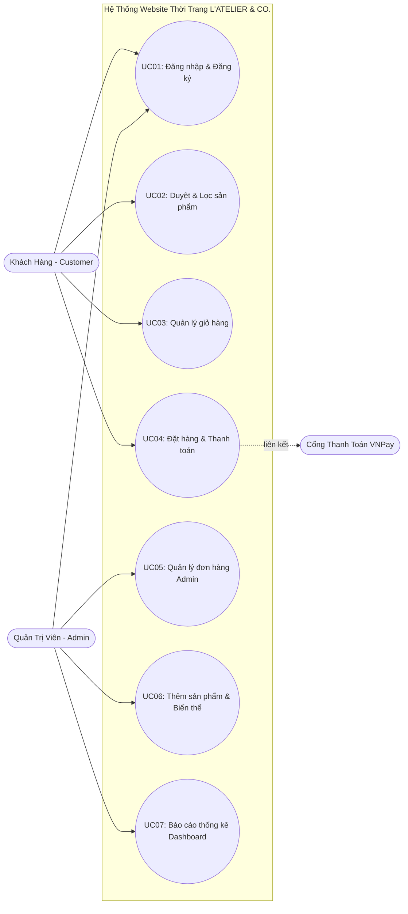

<div align="center">

*Hình 2.1*. Biểu đồ Use Case tổng quát toàn bộ hệ thống L'ATELIER & CO.

</div>

### 2.4.2 Biểu đồ Use Case phía Quản trị viên (Admin)

Phân rã chi tiết các ca sử dụng dành riêng cho nhóm tác nhân Quản trị viên:


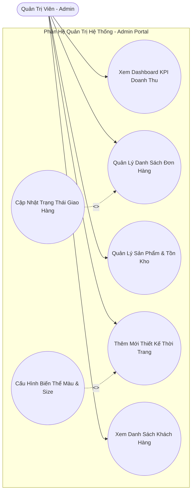

<div align="center">

*Hình 2.2*. Biểu đồ Use Case phân rã chức năng phía Quản trị viên (Admin)

</div>

### 2.4.3 Biểu đồ Use Case phía Người dùng (Khách hàng)

Phân rã chi tiết các ca sử dụng phục vụ hành trình trải nghiệm của Khách hàng:


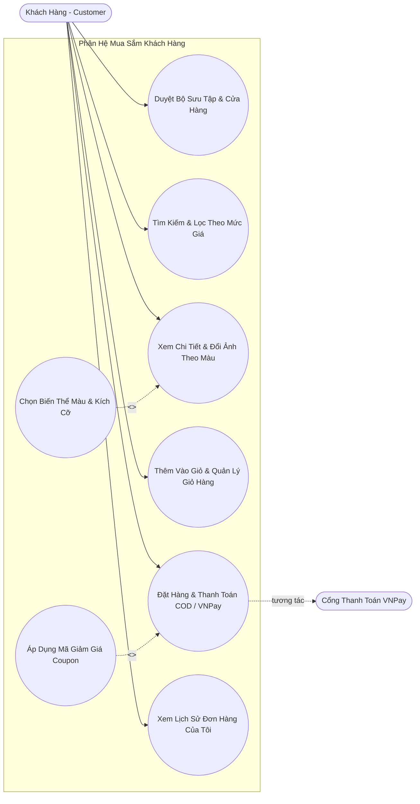

<div align="center">

*Hình 2.3*. Biểu đồ Use Case phân rã chức năng phía Khách hàng (Customer)

</div>

## 2.5 Mô tả chi tiết các Use Case chính

Dưới đây là bảng đặc tả chi tiết 7 ca sử dụng cốt lõi của hệ thống theo đúng định dạng chuẩn của trường gồm 10 mục nội dung và sơ đồ mô hình hóa đi kèm:

### 2.5.1 Use case Đăng ký và Đăng nhập hệ thống (UC_01)

<div align="center">

*Bảng 2.1*. Mô tả chi tiết use case Đăng ký và Đăng nhập hệ thống (`UC_01`)

</div>

| Mục | Nội dung chi tiết |
|:---|:---|
| **Mã Use case** | `UC_01` |
| **Tên Use case** | Đăng ký và Đăng nhập hệ thống |
| **Tác nhân** | Khách hàng, Quản trị viên |
| **Mô tả** | Cung cấp cơ chế xác thực danh tính người dùng bằng email và mật khẩu hoặc đăng ký tài khoản mới; cấp phát mã định danh JWT Token an toàn để sử dụng các dịch vụ của website. |
| **Sự kiện kích hoạt** | Người dùng nhấp vào biểu tượng tài khoản (User Icon) trên thanh Header của website. |
| **Tiền điều kiện** | Người dùng đã mở website trên trình duyệt và thiết bị có kết nối Internet ổn định. |
| **Luồng sự kiện chính** | **Bước 1 [Người dùng]:** Bấm vào icon tài khoản trên Header, modal xác thực (`AuthModal`) mở ra.<br>**Bước 2 [Người dùng]:** Nhập Địa chỉ Email và Mật khẩu (hoặc nhấp nút chọn tài khoản mẫu nhanh `[Admin]` / `[Khách Hàng]`).<br>**Bước 3 [Người dùng]:** Bấm nút 'ĐĂNG NHẬP' (hoặc chuyển tab 'ĐĂNG KÝ', điền họ tên, số điện thoại rồi bấm Đăng ký).<br>**Bước 4 [Hệ thống]:** Frontend gửi yêu cầu `POST /api/v1/auth/login` tới máy chủ Backend.<br>**Bước 5 [Hệ thống]:** Backend kiểm tra tài khoản trong bảng `users`, xác thực mật khẩu qua hàm `BCryptPasswordEncoder.matches()`.<br>**Bước 6 [Hệ thống]:** Nếu thông tin khớp, máy chủ sinh chuỗi JWT Token có thời hạn 24 giờ và trả về phản hồi 200 OK chứa đối tượng `UserDto`.<br>**Bước 7 [Hệ thống]:** Frontend lưu mã token vào `localStorage.luxe_token`, lưu thông tin người dùng vào `localStorage.luxe_user`, đóng modal và hiển thị thông báo Toast chào mừng. |
| **Luồng sự kiện thay thế** | **STT 1 [Hệ thống]:** Nếu email không tồn tại hoặc mật khẩu không chính xác, Backend trả về lỗi 401 Unauthorized kèm thông báo: *'Email hoặc mật khẩu không chính xác'*. Giao diện hiển thị cảnh báo đỏ và giữ nguyên modal để người dùng nhập lại.<br>**STT 2 [Hệ thống]:** Khi đăng ký, nếu địa chỉ email đã tồn tại trong cơ sở dữ liệu, hệ thống trả về thông báo: *'Email này đã được đăng ký tài khoản'*.<br>**STT 3 [Hệ thống]:** Nếu cơ sở dữ liệu gặp sự cố kết nối, hệ thống thông báo lỗi máy chủ nội bộ. |
| **Hậu điều kiện** | Người dùng được đăng nhập thành công vào hệ thống; trạng thái phiên được duy trì; giao diện Header chuyển sang hiển thị tên người dùng và các menu theo đúng quyền hạn (Khách hàng hoặc Quản trị viên). |


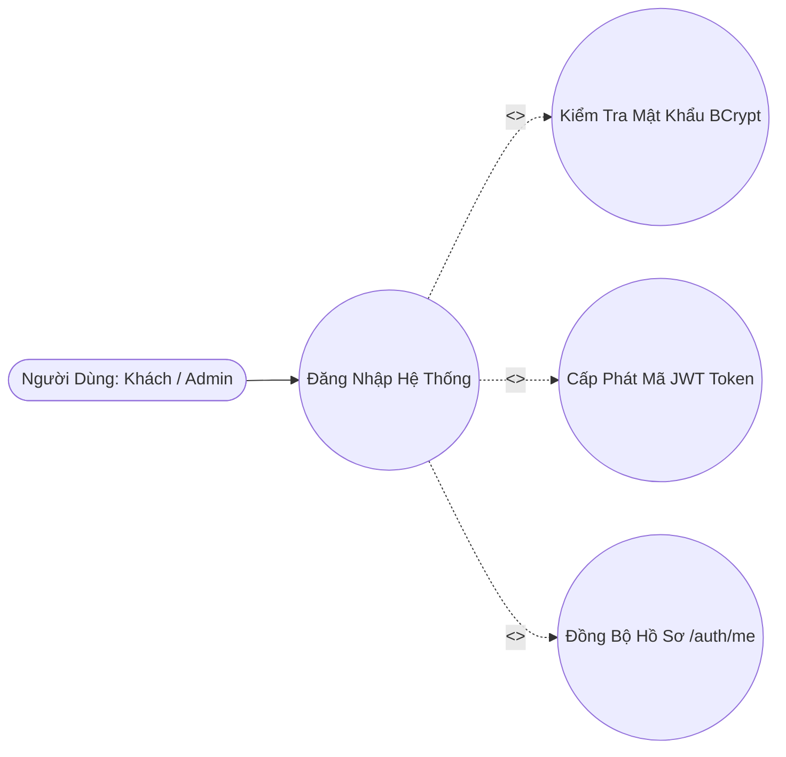

<div align="center">

*Hình 2.4*. Mô hình hóa use case Đăng ký và Đăng nhập hệ thống (`UC_01`)

</div>

### 2.5.2 Use case Xem chi tiết và Lựa chọn biến thể sản phẩm (UC_02)

<div align="center">

*Bảng 2.2*. Mô tả chi tiết use case Xem chi tiết và Lựa chọn biến thể sản phẩm (`UC_02`)

</div>

| Mục | Nội dung chi tiết |
|:---|:---|
| **Mã Use case** | `UC_02` |
| **Tên Use case** | Xem chi tiết và Lựa chọn biến thể sản phẩm |
| **Tác nhân** | Khách hàng |
| **Mô tả** | Cho phép khách hàng tìm hiểu kỹ lưỡng thông tin trang phục may đo (chất liệu vải cao cấp, cách giặt ủi, bảng size), tương tác xem hình ảnh theo màu sắc và chọn biến thể kích cỡ theo tồn kho thực tế. |
| **Sự kiện kích hoạt** | Khách hàng nhấp vào thẻ sản phẩm tại Trang chủ hoặc Trang cửa hàng. |
| **Tiền điều kiện** | Sản phẩm đang ở trạng thái kích hoạt kinh doanh (`is_active = true`) trong cơ sở dữ liệu. |
| **Luồng sự kiện chính** | **Bước 1 [Khách hàng]:** Nhấp vào sản phẩm, trình duyệt chuyển hướng đến `ProductDetailPage` theo slug tương ứng.<br>**Bước 2 [Hệ thống]:** Frontend gọi API `GET /api/v1/products/slug/{slug}`.<br>**Bước 3 [Hệ thống]:** Backend truy vấn bảng `products`, kết hợp nạp danh sách `product_variants` và `product_images` theo màu.<br>**Bước 4 [Hệ thống]:** Hiển thị chi tiết: Tên sản phẩm, Giá bán, Giá gốc, Chất liệu vải, Hướng dẫn bảo quản, Mô tả thiết kế và khối chọn Màu sắc.<br>**Bước 5 [Khách hàng]:** Nhấp chọn một màu sắc mong muốn (ví dụ: Đen Onyx hoặc Vàng Champagne).<br>**Bước 6 [Hệ thống]:** Giao diện tự động đổi ảnh lớn sang ảnh màu tương ứng, đồng thời lọc và nạp danh sách kích cỡ (Size S, M, L) thuộc màu đó.<br>**Bước 7 [Khách hàng]:** Bấm chọn kích cỡ, hệ thống hiển thị chính xác số lượng tồn kho còn lại trong kho hàng. |
| **Luồng sự kiện thay thế** | **STT 1 [Hệ thống]:** Nếu một biến thể có tồn kho bằng 0 (`stock_quantity = 0`), nút kích cỡ chuyển sang trạng thái bị vô hiệu hóa (disabled) kèm dòng thông báo: *'Hết hàng tạm thời'*.<br>**STT 2 [Hệ thống]:** Nếu đường dẫn slug sản phẩm không tồn tại trong hệ thống, Backend phản hồi 404 Not Found; giao diện hiển thị thông báo sản phẩm không tồn tại hoặc đã ngừng kinh doanh. |
| **Hậu điều kiện** | Khách hàng đã chọn được biến thể màu sắc và kích cỡ hợp lệ, sẵn sàng thực hiện thao tác thêm vào giỏ hàng hoặc mua ngay. |


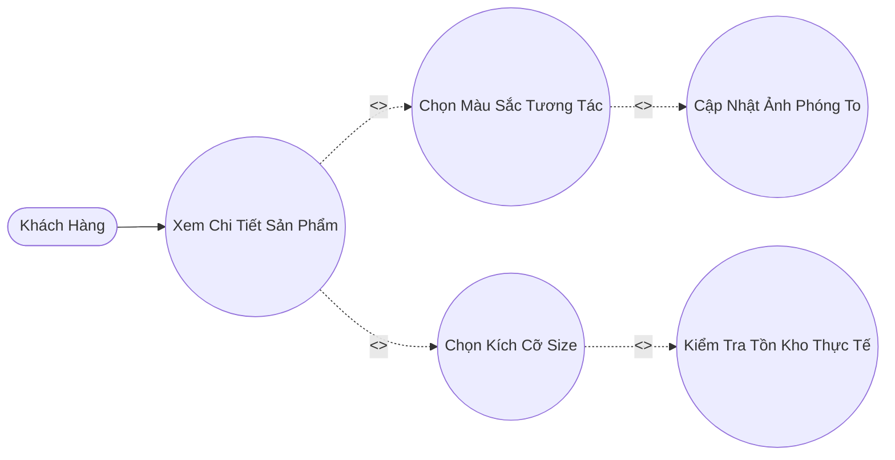

<div align="center">

*Hình 2.5*. Mô hình hóa use case Xem chi tiết và Lựa chọn biến thể sản phẩm (`UC_02`)

</div>

### 2.5.3 Use case Quản lý giỏ hàng mua sắm (UC_03)

<div align="center">

*Bảng 2.3*. Mô tả chi tiết use case Quản lý giỏ hàng mua sắm (`UC_03`)

</div>

| Mục | Nội dung chi tiết |
|:---|:---|
| **Mã Use case** | `UC_03` |
| **Tên Use case** | Quản lý giỏ hàng mua sắm |
| **Tác nhân** | Khách hàng |
| **Mô tả** | Cho phép khách hàng thêm các thiết kế thời trang đã chọn vào túi mua sắm, theo dõi danh sách mặt hàng, điều chỉnh số lượng hoặc xóa mặt hàng; hỗ trợ giỏ hàng cho cả khách vãng lai và thành viên đăng nhập. |
| **Sự kiện kích hoạt** | Khách hàng nhấp nút 'THÊM VÀO TÚI' hoặc bấm vào biểu tượng túi mua sắm trên Header. |
| **Tiền điều kiện** | Khách hàng đã chọn đầy đủ biến thể Màu sắc và Kích cỡ hợp lệ. |
| **Luồng sự kiện chính** | **Bước 1 [Khách hàng]:** Bấm nút 'THÊM VÀO TÚI' tại trang chi tiết sản phẩm.<br>**Bước 2 [Hệ thống]:** Frontend gửi yêu cầu `POST /api/v1/cart/items` mang theo `variantId`, `quantity` và `sessionId` (nếu chưa đăng nhập) hoặc Token (nếu đã đăng nhập).<br>**Bước 3 [Hệ thống]:** Backend kiểm tra tồn kho, tạo mới hoặc cộng dồn số lượng bản ghi trong bảng `cart_items` và tính lại tổng tiền.<br>**Bước 4 [Hệ thống]:** Trả về đối tượng `CartDto` cập nhật; Frontend mở thanh trượt `CartDrawer` bên phải màn hình và hiển thị thông báo Toast thành công.<br>**Bước 5 [Khách hàng]:** Có thể nhấp nút `[+]` để tăng số lượng hoặc `[-]` để giảm số lượng.<br>**Bước 6 [Hệ thống]:** Frontend gọi `PUT /api/v1/cart/items/{itemId}` để cập nhật số lượng trên máy chủ.<br>**Bước 7 [Khách hàng]:** Có thể nhấp nút icon thùng rác để xóa bỏ sản phẩm; Backend gọi `DELETE /api/v1/cart/items/{itemId}` và cập nhật lại giao diện. |
| **Luồng sự kiện thay thế** | **STT 1 [Hệ thống]:** Nếu khách hàng yêu cầu số lượng vượt quá số lượng tồn kho thực tế của biến thể, Backend ném ngoại lệ `BadRequestException: 'Số lượng yêu cầu vượt quá tồn kho khả dụng'`. Frontend hiển thị cảnh báo và giữ nguyên số lượng cũ.<br>**STT 2 [Hệ thống]:** Nếu giỏ hàng không còn sản phẩm nào, hệ thống hiển thị thông báo *'Túi mua sắm của bạn đang trống'* kèm nút chuyển hướng đến trang Cửa hàng. |
| **Hậu điều kiện** | Giỏ hàng của khách hàng được cập nhật đồng bộ trên máy chủ; số lượng hiển thị trên huy hiệu icon túi xách trên Header được cập nhật chính xác. |


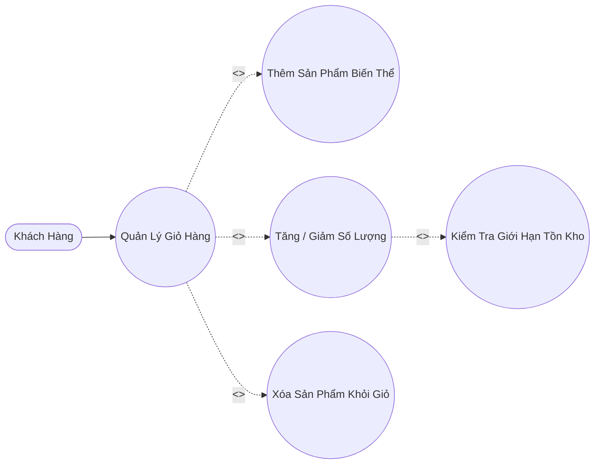

<div align="center">

*Hình 2.6*. Mô hình hóa use case Quản lý giỏ hàng mua sắm (`UC_03`)

</div>

### 2.5.4 Use case Đặt hàng và Thanh toán trực tuyến VNPay (UC_04)

<div align="center">

*Bảng 2.4*. Mô tả chi tiết use case Đặt hàng và Thanh toán trực tuyến VNPay (`UC_04`)

</div>

| Mục | Nội dung chi tiết |
|:---|:---|
| **Mã Use case** | `UC_04` |
| **Tên Use case** | Đặt hàng và Thanh toán trực tuyến VNPay |
| **Tác nhân** | Khách hàng, Cổng thanh toán VNPay |
| **Mô tả** | Khách hàng điền thông tin giao nhận, áp dụng mã ưu đãi Coupon, lựa chọn phương thức thanh toán (COD hoặc VNPay Sandbox) và hoàn tất đơn hàng may đo. |
| **Sự kiện kích hoạt** | Khách hàng bấm nút 'TIẾN HÀNH ĐẶT HÀNG' từ giỏ hàng. |
| **Tiền điều kiện** | Giỏ hàng có ít nhất một sản phẩm hợp lệ và các sản phẩm vẫn còn tồn kho. |
| **Luồng sự kiện chính** | **Bước 1 [Khách hàng]:** Kiểm tra danh sách mặt hàng tại trang `CheckoutPage`, điền Họ tên, Số điện thoại, Email, Địa chỉ giao hàng chi tiết.<br>**Bước 2 [Khách hàng]:** Nhập mã Coupon (ví dụ: `LUXE10`) và bấm 'Áp dụng'; hệ thống xác thực và giảm trừ tiền trực tiếp trên hóa đơn.<br>**Bước 3 [Khách hàng]:** Chọn phương thức thanh toán 'Thanh toán trực tuyến qua VNPAY' và nhấp 'HOÀN TẤT ĐẶT HÀNG'.<br>**Bước 4 [Hệ thống]:** Backend tạo bản ghi đơn hàng trong bảng `orders` ở trạng thái `PENDING`, giảm trừ số lượng tồn kho trong `product_variants` và xóa rỗng giỏ hàng trong cùng một Transaction.<br>**Bước 5 [Hệ thống]:** Frontend mở modal mô phỏng Cổng thanh toán VNPay Sandbox với mã đơn hàng và số tiền tương ứng.<br>**Bước 6 [Khách hàng]:** Kiểm tra thông tin và nhấp nút 'XÁC NHẬN THANH TOÁN THÀNH CÔNG'.<br>**Bước 7 [Hệ thống]:** Backend gọi API `/payments/confirm`, lưu bản ghi giao dịch trong bảng `payments` và chuyển trạng thái đơn hàng sang `PROCESSING`.<br>**Bước 8 [Hệ thống]:** Điều hướng khách hàng đến trang `OrderConfirmationPage` hiển thị đầy đủ hóa đơn may đo cao cấp. |
| **Luồng sự kiện thay thế** | **STT 1 [Khách hàng]:** Nếu khách hàng chọn phương thức 'Thanh toán khi nhận hàng (COD)', hệ thống lưu đơn hàng `PENDING` và chuyển thẳng tới trang xác nhận đơn hàng mà không qua bước thanh toán điện tử.<br>**STT 2 [Khách hàng]:** Nếu khách hàng bấm hủy thanh toán trên cổng VNPay, đơn hàng vẫn được lưu lại ở trạng thái `PENDING` để khách hàng có thể thanh toán sau trong trang 'Đơn hàng của tôi'.<br>**STT 3 [Hệ thống]:** Nếu mã Coupon nhập vào không hợp lệ hoặc không đạt giá trị tối thiểu, hệ thống hiển thị thông báo lỗi và giữ nguyên giá gốc của đơn hàng. |
| **Hậu điều kiện** | Đơn hàng được lưu trữ an toàn trong cơ sở dữ liệu; số lượng tồn kho của các biến thể được giảm trừ chính xác; giỏ hàng được làm sạch và khách hàng nhận được mã hóa đơn tra cứu. |


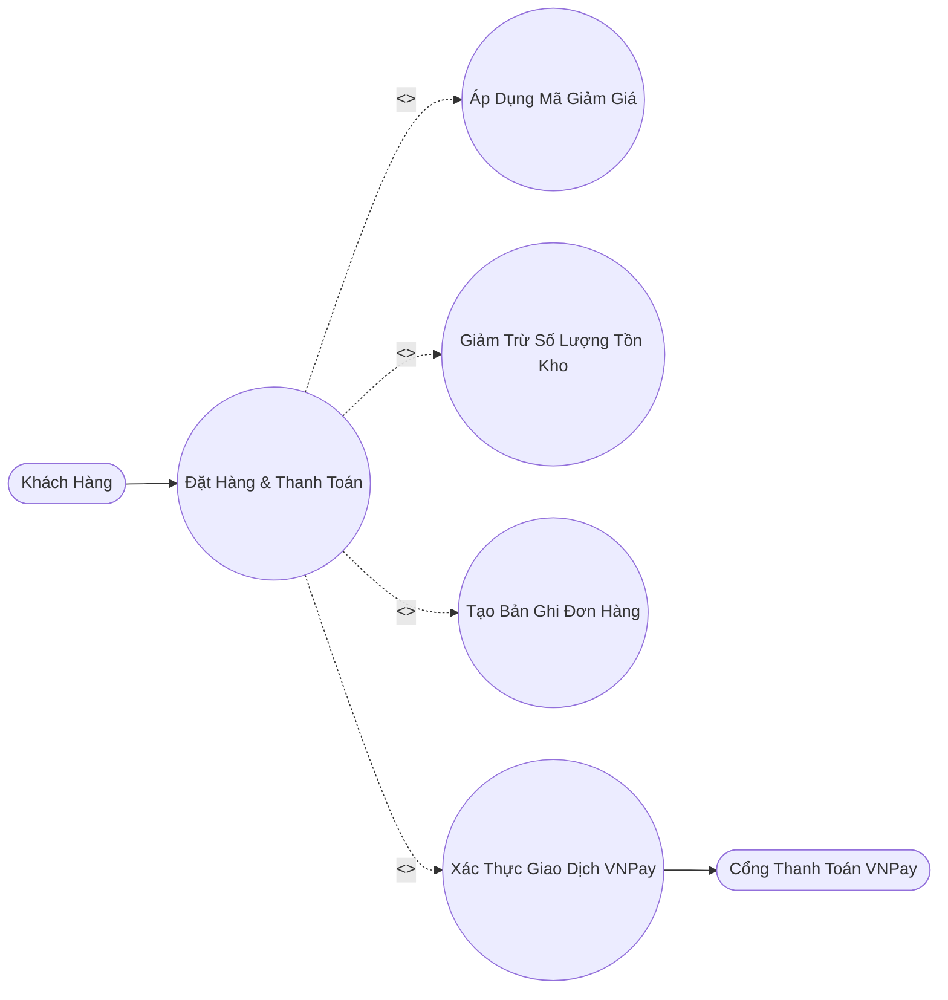

<div align="center">

*Hình 2.7*. Mô hình hóa use case Đặt hàng và Thanh toán trực tuyến VNPay (`UC_04`)

</div>

### 2.5.5 Use case Quản lý đơn hàng phía Quản trị viên (UC_05)

<div align="center">

*Bảng 2.5*. Mô tả chi tiết use case Quản lý đơn hàng phía Quản trị viên (`UC_05`)

</div>

| Mục | Nội dung chi tiết |
|:---|:---|
| **Mã Use case** | `UC_05` |
| **Tên Use case** | Quản lý đơn hàng phía Quản trị viên |
| **Tác nhân** | Quản trị viên (Admin) |
| **Mô tả** | Cung cấp công cụ cho quản trị viên theo dõi toàn bộ danh sách đơn đặt hàng của khách hàng, xem chi tiết mặt hàng may đo, lọc đơn theo tiến độ và cập nhật trạng thái giao hàng. |
| **Sự kiện kích hoạt** | Quản trị viên nhấp vào tab 'Quản Lý Đơn Hàng' tại giao diện Admin Portal. |
| **Tiền điều kiện** | Quản trị viên đã đăng nhập tài khoản có quyền `ROLE_ADMIN`. |
| **Luồng sự kiện chính** | **Bước 1 [Admin]:** Nhấp chọn tab 'Quản Lý Đơn Hàng' trên thanh điều hướng quản trị.<br>**Bước 2 [Hệ thống]:** Frontend gửi yêu cầu `GET /api/v1/admin/orders` kèm mã JWT Token trong Header.<br>**Bước 3 [Hệ thống]:** Backend kiểm tra phân quyền, truy vấn bảng `orders` và trả về danh sách đơn hàng được sắp xếp theo thời gian mới nhất.<br>**Bước 4 [Hệ thống]:** Hiển thị bảng danh sách đơn hàng gồm: Mã đơn, Khách hàng, Số điện thoại, Địa chỉ giao, Tổng tiền, Trạng thái đơn (thẻ màu Badge) và Danh sách sản phẩm chi tiết.<br>**Bước 5 [Admin]:** Sử dụng các nút bấm lọc đơn (`TẤT CẢ`, `CHỜ XỬ LÝ`, `ĐANG XỬ LÝ`, `ĐANG GIAO HÀNG`, `ĐÃ GIAO`, `ĐÃ HỦY`).<br>**Bước 6 [Admin]:** Tại một đơn hàng cụ thể, nhấp vào dropdown trạng thái và chọn trạng thái mới (ví dụ: chuyển từ `PROCESSING` sang `SHIPPED`).<br>**Bước 7 [Hệ thống]:** Frontend gửi lệnh `PUT /api/v1/admin/orders/{orderId}/status` tới Backend; máy chủ cập nhật trường `order_status` trong cơ sở dữ liệu và thông báo cập nhật thành công. |
| **Luồng sự kiện thay thế** | **STT 1 [Hệ thống]:** Nếu đơn hàng đã hoàn tất ở trạng thái `DELIVERED` (Đã giao thành công) hoặc `CANCELLED` (Đã hủy), hệ thống khóa và không cho phép đổi ngược về trạng thái chờ xử lý để đảm bảo tính toàn vẹn dữ liệu sổ sách kế toán. |
| **Hậu điều kiện** | Trạng thái đơn hàng được lưu trữ cập nhật nhất quán giữa máy chủ Backend, giao diện quản trị viên và trang tra cứu đơn hàng của khách hàng. |


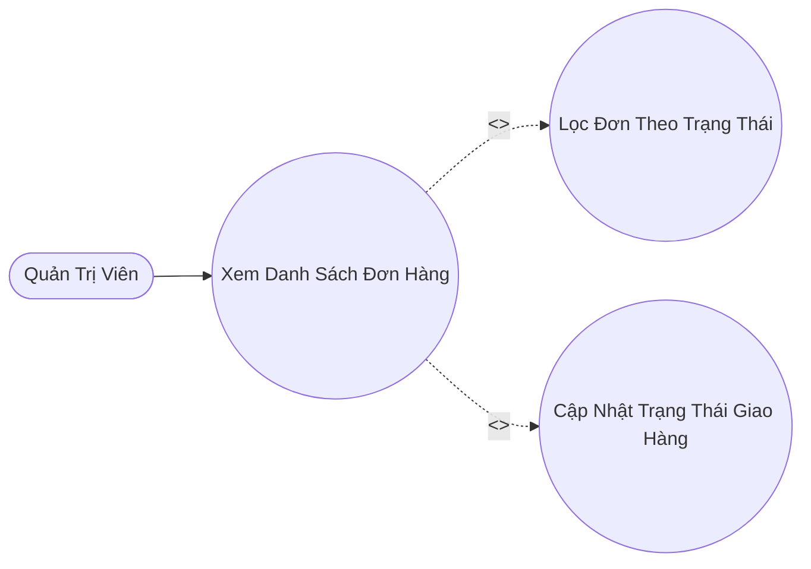

<div align="center">

*Hình 2.8*. Mô hình hóa use case Quản lý đơn hàng phía Quản trị viên (`UC_05`)

</div>

### 2.5.6 Use case Thêm mới sản phẩm và biến thể tồn kho (UC_06)

<div align="center">

*Bảng 2.6*. Mô tả chi tiết use case Thêm mới sản phẩm và biến thể tồn kho (`UC_06`)

</div>

| Mục | Nội dung chi tiết |
|:---|:---|
| **Mã Use case** | `UC_06` |
| **Tên Use case** | Thêm mới sản phẩm và biến thể tồn kho |
| **Tác nhân** | Quản trị viên (Admin) |
| **Mô tả** | Cho phép quản trị viên xuất bản mẫu thiết kế thời trang mới lên website, thiết lập các thuộc tính gốc (chất liệu, bảo quản, giá bán) và khởi tạo danh sách các biến thể tồn kho theo màu sắc và kích cỡ. |
| **Sự kiện kích hoạt** | Quản trị viên nhấp vào nút '+ THÊM THIẾT KẾ MỚI' tại tab 'Sản Phẩm & Tồn Kho'. |
| **Tiền điều kiện** | Tài khoản quản trị viên đã đăng nhập và đang hoạt động. |
| **Luồng sự kiện chính** | **Bước 1 [Admin]:** Nhấp nút '+ THÊM THIẾT KẾ MỚI', modal biểu mẫu tạo sản phẩm mở ra.<br>**Bước 2 [Admin]:** Điền Tên thiết kế, chọn Danh mục, Thương hiệu, nhập Giá bán, Giá gốc, Chất liệu vải (ví dụ: Cashmere, Lụa tơ tằm), Hướng dẫn giặt ủi, Mô tả và link ảnh đại diện chính.<br>**Bước 3 [Admin]:** Tại bảng danh sách biến thể, thêm các dòng màu sắc (Tên màu, Mã màu hex), Kích cỡ may đo (S, M, L), Số lượng tồn kho và Giá biến thể tương ứng.<br>**Bước 4 [Admin]:** Bấm nút 'LƯU VÀ ĐĂNG THIẾT KẾ'.<br>**Bước 5 [Hệ thống]:** Frontend kiểm tra tính đầy đủ của dữ liệu và gửi yêu cầu `POST /api/v1/admin/products` kèm `CreateProductRequest`.<br>**Bước 6 [Hệ thống]:** Backend tự động sinh chuỗi slug chuẩn SEO, lưu bản ghi vào bảng `products`, đồng thời lưu toàn bộ danh sách biến thể con vào `product_variants` và `product_images` trong cùng một giao dịch `@Transactional`.<br>**Bước 7 [Hệ thống]:** Trả về đối tượng `ProductDetailDto` thành công; Frontend đóng modal, nạp lại danh sách sản phẩm và hiển thị thông báo thành công. |
| **Luồng sự kiện thay thế** | **STT 1 [Hệ thống]:** Nếu quản trị viên bỏ sót các trường thông tin bắt buộc (Tên sản phẩm, Giá bán, Danh mục) hoặc danh sách biến thể trống, hệ thống hiển thị thông báo lỗi màu đỏ tại chân biểu mẫu và ngăn chặn gửi dữ liệu lên máy chủ.<br>**STT 2 [Hệ thống]:** Nếu tên thiết kế bị trùng lặp slug, Backend tự động ghép thêm mã hậu tố thời gian ngẫu nhiên để đảm bảo tính duy nhất của đường dẫn URL. |
| **Hậu điều kiện** | Mẫu thiết kế thời trang mới cùng toàn bộ các biến thể màu sắc và kích cỡ tồn kho được lưu trữ thành công vào MySQL và xuất hiện tức thì trên trang Cửa hàng cho khách đặt mua. |


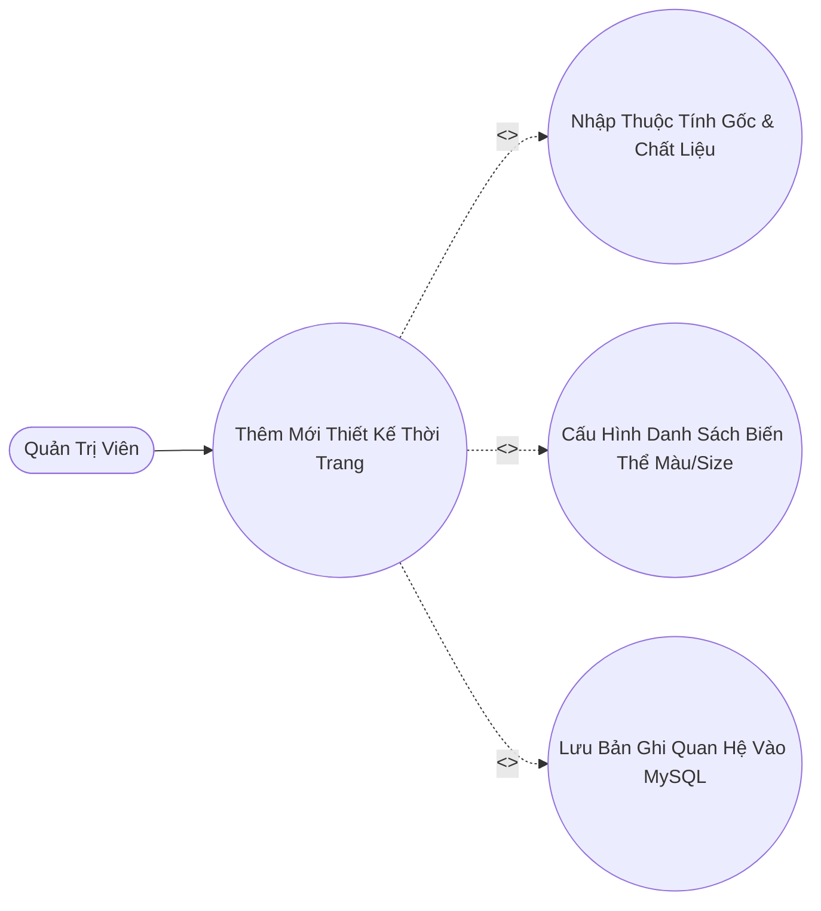

<div align="center">

*Hình 2.9*. Mô hình hóa use case Thêm mới sản phẩm và cấu hình biến thể (`UC_06`)

</div>

### 2.5.7 Use case Xem thống kê Dashboard phân tích kinh doanh (UC_07)

<div align="center">

*Bảng 2.7*. Mô tả chi tiết use case Xem thống kê Dashboard phân tích kinh doanh (`UC_07`)

</div>

| Mục | Nội dung chi tiết |
|:---|:---|
| **Mã Use case** | `UC_07` |
| **Tên Use case** | Xem thống kê Dashboard phân tích kinh doanh |
| **Tác nhân** | Quản trị viên (Admin) |
| **Mô tả** | Cung cấp cái nhìn toàn diện về các chỉ số tài chính, tổng số lượng đơn hàng, tình trạng đơn hàng chờ xử lý và các cảnh báo tồn kho thấp theo thời gian thực. |
| **Sự kiện kích hoạt** | Quản trị viên nhấp vào menu 'ADMIN PORTAL' hoặc chọn tab 'Tổng Quan (Dashboard)'. |
| **Tiền điều kiện** | Quản trị viên đã đăng nhập tài khoản có quyền `ROLE_ADMIN`. |
| **Luồng sự kiện chính** | **Bước 1 [Admin]:** Truy cập URL `/admin` hoặc bấm nút 'LÀM MỚI DỮ LIỆU'.<br>**Bước 2 [Hệ thống]:** Frontend gọi đồng thời các API Backend: `GET /api/v1/admin/dashboard`, `GET /api/v1/admin/orders`, `GET /api/v1/products`, `GET /api/v1/admin/users`.<br>**Bước 3 [Hệ thống]:** Backend tính toán: Tổng doanh thu thực tế (đã loại trừ đơn hủy), Tổng đơn hàng, Số đơn chờ xử lý (`PENDING`), Tổng số thiết kế đang mở bán, Tổng số khách hàng đăng ký.<br>**Bước 4 [Hệ thống]:** Frontend kết xuất 5 thẻ KPI đầu trang kèm biểu tượng vectơ tinh tế.<br>**Bước 5 [Hệ thống]:** Hiển thị thanh tỷ lệ phần trăm phân bổ trạng thái đơn hàng (Xanh lá: Đã giao, Đỏ: Đã hủy, Vàng: Chờ xử lý, Xanh dương: Đang giao).<br>**Bước 6 [Hệ thống]:** Hiển thị bảng danh sách các đơn hàng mới phát sinh và bảng danh sách các biến thể có số lượng tồn kho thấp dưới 10 sản phẩm để cảnh báo nhập thêm hàng. |
| **Luồng sự kiện thay thế** | **STT 1 [Hệ thống]:** Nếu hệ thống mới khởi tạo chưa có đơn hàng nào, các thẻ chỉ số hiển thị giá trị mặc định (0 đ, 0 đơn hàng, 0 khách hàng) mà không bị gián đoạn hay phát sinh lỗi giao diện. |
| **Hậu điều kiện** | Quản trị viên nắm bắt nhanh chóng và chính xác toàn bộ bức tranh tài chính và hoạt động vận hành của xưởng may đo thời trang. |


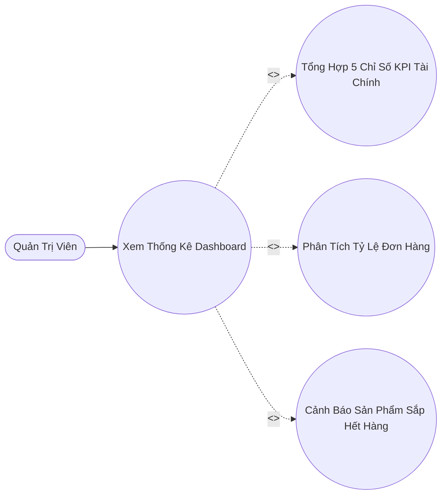

<div align="center">

*Hình 2.10*. Mô hình hóa use case Báo cáo thống kê Dashboard (`UC_07`)

</div>

## 2.6 Thiết kế Backend

### 2.6.1 Thiết kế biểu đồ mô tả các chức năng (Sequence Diagram & VOPC Class Diagram)

Thiết kế Backend của dự án áp dụng mô hình phân tích đối tượng **Boundary - Control - Entity (BCE)** theo chuẩn Rational Unified Process (RUP) và UML:

- **Tầng Biên (Boundary):** Đại diện cho các giao diện người dùng (UI Components) tiếp nhận thao tác trực tiếp từ chuột/bàn phím của người dùng, hoặc các cổng giao tiếp bên ngoài (như Cổng VNPay, Cổng cơ sở dữ liệu `ICSDL`).

- **Tầng Điều khiển (Control):** Đại diện cho các bộ điều phối điều khiển luồng nghiệp vụ gồm các lớp REST Controller và các dịch vụ Service xử lý thuật toán.

- **Tầng Thực thể (Entity):** Đại diện cho các đối tượng nghiệp vụ cốt lõi mang dữ liệu và các kho lưu trữ Repository tương tác với cơ sở dữ liệu.

#### 2.6.1.1 Chức năng Đăng nhập hệ thống

Biểu đồ trình tự thể hiện quá trình xác thực tài khoản và cấp phát mã JWT Token:


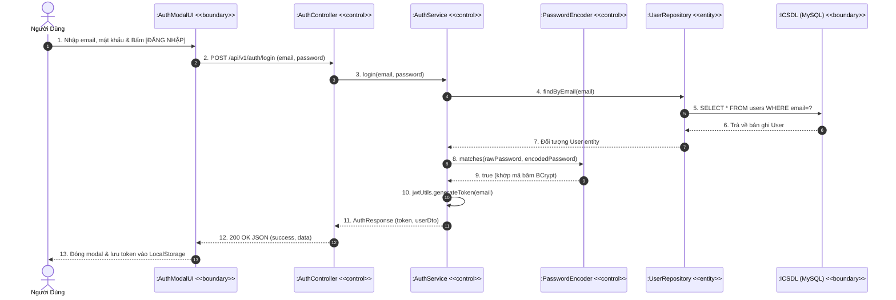

<div align="center">

*Hình 2.11*. Biểu đồ trình tự (Sequence Diagram) chức năng Đăng nhập hệ thống chuẩn BCE

</div>

#### 2.6.1.2 Chức năng Đặt hàng và Thanh toán trực tuyến VNPay

Biểu đồ trình tự mô tả quy trình tiếp nhận đơn hàng, giảm trừ tồn kho và xác nhận thanh toán điện tử qua cổng VNPay Sandbox:


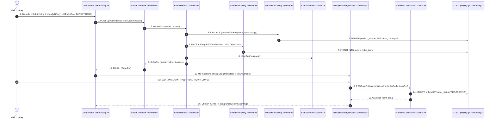

<div align="center">

*Hình 2.12*. Biểu đồ trình tự (Sequence Diagram) chức năng Đặt hàng và Thanh toán VNPay

</div>

#### 2.6.1.3 Chức năng Thêm mới sản phẩm quản trị

Biểu đồ trình tự mô tả quy trình lưu trữ đồng thời sản phẩm gốc và danh sách các biến thể tồn kho:


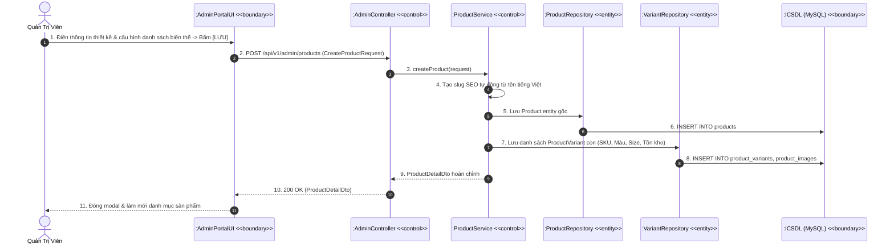

<div align="center">

*Hình 2.13*. Biểu đồ trình tự (Sequence Diagram) chức năng Thêm mới sản phẩm quản trị

</div>

#### 2.6.1.4 Biểu đồ lớp phân tích VOPC (View - Operation - Process - Control)

Biểu đồ lớp phân tích VOPC thể hiện cấu trúc tĩnh của các lớp tham gia hiện thực hóa các ca sử dụng theo đúng mẫu hình tham khảo của trường:


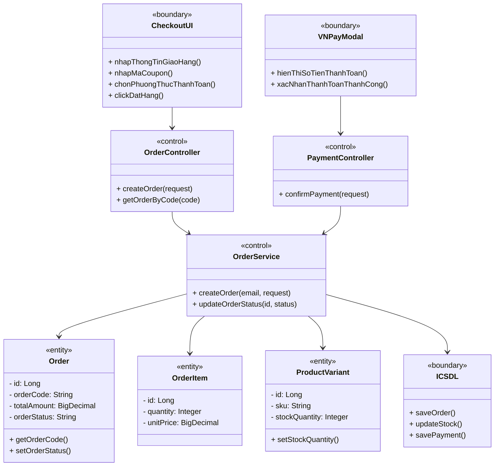

<div align="center">

*Hình 2.14*. Biểu đồ lớp phân tích VOPC cho ca sử dụng Đặt hàng và Thanh toán

</div>


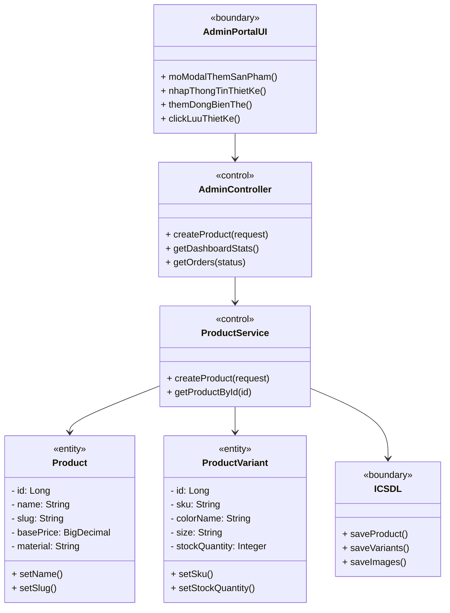

<div align="center">

*Hình 2.15*. Biểu đồ lớp phân tích VOPC cho ca sử dụng Quản trị sản phẩm

</div>

### 2.6.2 Biểu đồ lớp tổng thể (Overall Class Diagram)

Biểu đồ lớp tổng thể mô tả cấu trúc của các lớp thực thể trong hệ thống Backend và mối quan hệ giữa chúng:


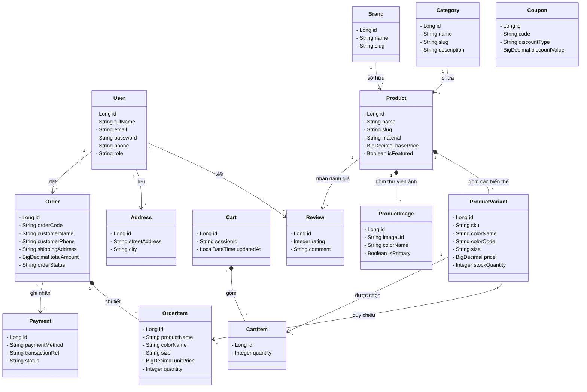

<div align="center">

*Hình 2.16*. Biểu đồ lớp tổng thể (Overall Class Diagram) hệ thống Backend

</div>

### 2.6.3 Thiết kế Cơ sở dữ liệu quan hệ (ERD và Data Dictionary 14 bảng)

Cơ sở dữ liệu `clothing_store` được thiết kế chuẩn hóa đạt dạng chuẩn 3NF gồm 14 bảng dữ liệu quan hệ liên kết bằng các ràng buộc khóa ngoại (Foreign Keys):


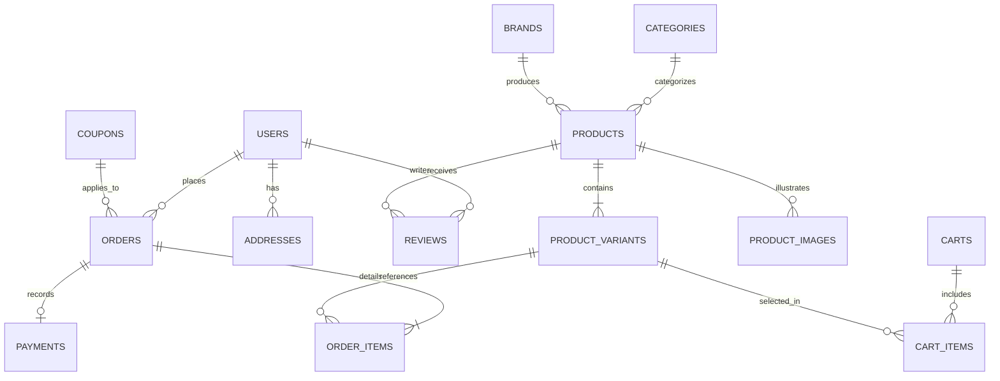

<div align="center">

*Hình 2.17*. Biểu đồ quan hệ thực thể (Entity Relationship Diagram - ERD) cơ sở dữ liệu

</div>

Dưới đây là từ điển dữ liệu chi tiết của 14 bảng trong cơ sở dữ liệu:

<div align="center">

*Bảng 2.8*. Cấu trúc bảng lưu trữ thông tin Người dùng (`users`)

</div>

| Tên cột | Kiểu dữ liệu | Khóa | Mặc định | Mô tả ý nghĩa |
|:---|:---|:---:|:---:|:---|
| `id` | BIGINT AUTO_INCREMENT | PK | None | Khóa chính định danh tài khoản người dùng duy nhất |
| `full_name` | VARCHAR(150) | | None | Họ và tên người dùng (lưu tiếng Việt UTF-8 chuẩn) |
| `email` | VARCHAR(150) | UNIQUE | None | Địa chỉ email duy nhất dùng đăng nhập hệ thống |
| `password` | VARCHAR(255) | | None | Mật khẩu tài khoản đã băm một chiều giải thuật BCrypt |
| `phone` | VARCHAR(20) | | NULL | Số điện thoại liên hệ giao hàng của người dùng |
| `role` | VARCHAR(50) | | 'ROLE_CUSTOMER' | Vai trò phân quyền: `ROLE_CUSTOMER` hoặc `ROLE_ADMIN` |
| `avatar_url` | VARCHAR(500) | | NULL | Đường dẫn URL hình ảnh đại diện người dùng |
| `is_active` | TINYINT(1) | | 1 | Trạng thái tài khoản (1: Đang hoạt động, 0: Đã khóa) |
| `created_at` | DATETIME | | CURRENT_TIMESTAMP | Thời điểm tạo tài khoản trong hệ thống |
| `updated_at` | DATETIME | | CURRENT_TIMESTAMP | Thời điểm cập nhật hồ sơ người dùng gần nhất |

<div align="center">

*Bảng 2.9*. Cấu trúc bảng lưu trữ Danh mục thời trang (`categories`)

</div>

| Tên cột | Kiểu dữ liệu | Khóa | Mặc định | Mô tả ý nghĩa |
|:---|:---|:---:|:---:|:---|
| `id` | BIGINT AUTO_INCREMENT | PK | None | Khóa chính danh mục sản phẩm |
| `name` | VARCHAR(100) | | None | Tên danh mục (ví dụ: Áo Blazer & Khoác Ngoài, Đầm Lụa) |
| `slug` | VARCHAR(100) | UNIQUE | None | Đường dẫn thân thiện SEO (ví dụ: `ao-blazer-khoac-ngoai`) |
| `description` | TEXT | | NULL | Mô tả phong cách thời trang của danh mục |
| `image_url` | VARCHAR(500) | | NULL | Hình ảnh đại diện banner danh mục |
| `parent_id` | BIGINT | FK | NULL | Tham chiếu danh mục cha (hỗ trợ phân cấp cây danh mục) |
| `display_order` | INT | | 0 | Thứ tự hiển thị trên thanh Menu điều hướng |

<div align="center">

*Bảng 2.10*. Cấu trúc bảng lưu trữ Thương hiệu may đo (`brands`)

</div>

| Tên cột | Kiểu dữ liệu | Khóa | Mặc định | Mô tả ý nghĩa |
|:---|:---|:---:|:---:|:---|
| `id` | BIGINT AUTO_INCREMENT | PK | None | Khóa chính thương hiệu thời trang |
| `name` | VARCHAR(100) | | None | Tên thương hiệu (ví dụ: L'ATELIER, NOIR & BLANC, AURA) |
| `slug` | VARCHAR(100) | UNIQUE | None | Đường dẫn URL chuẩn SEO của thương hiệu |
| `description` | TEXT | | NULL | Câu chuyện thương hiệu và phong cách may đo |
| `logo_url` | VARCHAR(500) | | NULL | Đường dẫn hình ảnh logo thương hiệu |

<div align="center">

*Bảng 2.11*. Cấu trúc bảng lưu trữ Thông tin sản phẩm gốc (`products`)

</div>

| Tên cột | Kiểu dữ liệu | Khóa | Mặc định | Mô tả ý nghĩa |
|:---|:---|:---:|:---:|:---|
| `id` | BIGINT AUTO_INCREMENT | PK | None | Khóa chính định danh sản phẩm |
| `name` | VARCHAR(255) | | None | Tên thiết kế thời trang may đo cao cấp |
| `slug` | VARCHAR(255) | UNIQUE | None | Đường dẫn URL sản phẩm (ví dụ: `dam-lua-to-tam-dang-dai`) |
| `description` | TEXT | | NULL | Mô tả chi tiết kiểu dáng, ve áo, đường cắt may đo |
| `material` | VARCHAR(255) | | NULL | Thành phần chất liệu vải cao cấp (Cashmere, Lụa 22 momme) |
| `care_instructions` | VARCHAR(255) | | NULL | Hướng dẫn giặt ủi và bảo quản đồ may đo |
| `base_price` | DECIMAL(12,2) | | None | Giá bán niêm yết tiêu chuẩn của sản phẩm |
| `original_price` | DECIMAL(12,2) | | NULL | Giá bán gốc trước khi giảm (hiển thị gạch ngang) |
| `category_id` | BIGINT | FK | None | Khóa ngoại tham chiếu tới bảng `categories` |
| `brand_id` | BIGINT | FK | None | Khóa ngoại tham chiếu tới bảng `brands` |
| `is_featured` | TINYINT(1) | | 0 | Đánh dấu sản phẩm nổi bật xuất hiện tại trang chủ |
| `is_active` | TINYINT(1) | | 1 | Trạng thái hiển thị sản phẩm trên cửa hàng |

<div align="center">

*Bảng 2.12*. Cấu trúc bảng lưu trữ Biến thể sản phẩm (`product_variants`)

</div>

| Tên cột | Kiểu dữ liệu | Khóa | Mặc định | Mô tả ý nghĩa |
|:---|:---|:---:|:---:|:---|
| `id` | BIGINT AUTO_INCREMENT | PK | None | Khóa chính định danh biến thể sản phẩm cụ thể |
| `product_id` | BIGINT | FK | None | Khóa ngoại liên kết bảng `products` (ON DELETE CASCADE) |
| `sku` | VARCHAR(100) | UNIQUE | None | Mã quản lý kho hàng duy nhất (ví dụ: `DRS-SILK-BLK-S`) |
| `color_name` | VARCHAR(100) | | None | Tên màu sắc thời trang (ví dụ: Đen Onyx, Vàng Champagne) |
| `color_code` | VARCHAR(20) | | NULL | Mã màu Hex hiển thị nút tròn màu sắc (ví dụ: `#111111`) |
| `size` | VARCHAR(20) | | None | Kích cỡ chuẩn may đo: `S`, `M`, `L`, `XL` |
| `price` | DECIMAL(12,2) | | None | Giá bán thực tế của biến thể tương ứng |
| `stock_quantity` | INT | | 0 | Số lượng sản phẩm còn lại trong kho hàng thực tế |
| `image_url` | VARCHAR(500) | | NULL | Hình ảnh đại diện cho màu sắc của biến thể |
| `is_active` | TINYINT(1) | | 1 | Trạng thái mở bán của biến thể |

<div align="center">

*Bảng 2.13*. Cấu trúc bảng lưu trữ Thư viện ảnh sản phẩm theo màu (`product_images`)

</div>

| Tên cột | Kiểu dữ liệu | Khóa | Mặc định | Mô tả ý nghĩa |
|:---|:---|:---:|:---:|:---|
| `id` | BIGINT AUTO_INCREMENT | PK | None | Khóa chính hình ảnh |
| `product_id` | BIGINT | FK | None | Khóa ngoại tham chiếu sản phẩm gốc `products` |
| `image_url` | VARCHAR(500) | | None | Đường dẫn URL hình ảnh chất lượng cao |
| `color_name` | VARCHAR(100) | | NULL | Tên màu sắc tương ứng để lọc hiển thị khi chọn màu |
| `is_primary` | TINYINT(1) | | 0 | Đánh dấu là ảnh chính đại diện cho thẻ sản phẩm |
| `display_order` | INT | | 0 | Thứ tự hiển thị trong thư viện ảnh chi tiết |

<div align="center">

*Bảng 2.14*. Cấu trúc bảng lưu trữ Giỏ hàng người dùng và giỏ ẩn danh (`carts`)

</div>

| Tên cột | Kiểu dữ liệu | Khóa | Mặc định | Mô tả ý nghĩa |
|:---|:---|:---:|:---:|:---|
| `id` | BIGINT AUTO_INCREMENT | PK | None | Khóa chính giỏ hàng |
| `user_id` | BIGINT | FK | NULL | Tham chiếu `users` (nếu khách hàng đã đăng nhập) |
| `session_id` | VARCHAR(100) | INDEX | NULL | Mã phiên ẩn danh lưu trên LocalStorage cho khách vãng lai |
| `created_at` | DATETIME | | CURRENT_TIMESTAMP | Thời điểm tạo giỏ hàng |
| `updated_at` | DATETIME | | CURRENT_TIMESTAMP | Thời điểm thêm hoặc sửa mặt hàng gần nhất |

<div align="center">

*Bảng 2.15*. Cấu trúc bảng lưu trữ Chi tiết mặt hàng trong giỏ (`cart_items`)

</div>

| Tên cột | Kiểu dữ liệu | Khóa | Mặc định | Mô tả ý nghĩa |
|:---|:---|:---:|:---:|:---|
| `id` | BIGINT AUTO_INCREMENT | PK | None | Khóa chính dòng sản phẩm trong giỏ |
| `cart_id` | BIGINT | FK | None | Khóa ngoại tham chiếu bảng giỏ hàng `carts` |
| `variant_id` | BIGINT | FK | None | Khóa ngoại tham chiếu biến thể sản phẩm `product_variants` |
| `quantity` | INT | | 1 | Số lượng đặt mua của biến thể |
| `created_at` | DATETIME | | CURRENT_TIMESTAMP | Thời điểm thêm vào giỏ hàng |

<div align="center">

*Bảng 2.16*. Cấu trúc bảng lưu trữ Đơn đặt hàng (`orders`)

</div>

| Tên cột | Kiểu dữ liệu | Khóa | Mặc định | Mô tả ý nghĩa |
|:---|:---|:---:|:---:|:---|
| `id` | BIGINT AUTO_INCREMENT | PK | None | Khóa chính đơn đặt hàng |
| `order_code` | VARCHAR(50) | UNIQUE | None | Mã đơn hàng tra cứu duy nhất (ví dụ: `ORD-20261019-001`) |
| `user_id` | BIGINT | FK | NULL | Khóa ngoại tham chiếu bảng `users` (NULL nếu khách vãng lai) |
| `customer_name` | VARCHAR(150) | | None | Họ và tên người nhận hàng |
| `customer_email` | VARCHAR(150) | | None | Email người nhận để gửi hóa đơn xác nhận |
| `customer_phone` | VARCHAR(20) | | None | Số điện thoại liên hệ giao hàng |
| `shipping_address` | VARCHAR(500) | | None | Địa chỉ giao nhận hàng chi tiết |
| `subtotal` | DECIMAL(12,2) | | None | Tổng giá trị tiền hàng trước giảm giá |
| `shipping_fee` | DECIMAL(12,2) | | 0.00 | Phí vận chuyển (miễn phí đơn trên 1.000.000đ) |
| `discount_amount` | DECIMAL(12,2) | | 0.00 | Số tiền được khấu trừ từ mã giảm giá Coupon |
| `total_amount` | DECIMAL(12,2) | | None | Tổng số tiền thực tế khách hàng thanh toán |
| `coupon_code` | VARCHAR(50) | | NULL | Mã giảm giá đã áp dụng |
| `order_status` | VARCHAR(50) | | 'PENDING' | Trạng thái: `PENDING`, `PROCESSING`, `SHIPPED`, `DELIVERED`, `CANCELLED` |
| `note` | VARCHAR(500) | | NULL | Ghi chú yêu cầu may đo hoặc giao hàng từ người mua |
| `created_at` | DATETIME | | CURRENT_TIMESTAMP | Thời điểm phát sinh đơn đặt hàng |

<div align="center">

*Bảng 2.17*. Cấu trúc bảng lưu trữ Chi tiết sản phẩm trong đơn hàng (`order_items`)

</div>

| Tên cột | Kiểu dữ liệu | Khóa | Mặc định | Mô tả ý nghĩa |
|:---|:---|:---:|:---:|:---|
| `id` | BIGINT AUTO_INCREMENT | PK | None | Khóa chính chi tiết đơn hàng |
| `order_id` | BIGINT | FK | None | Khóa ngoại tham chiếu bảng đơn hàng `orders` |
| `variant_id` | BIGINT | FK | None | Khóa ngoại tham chiếu biến thể sản phẩm |
| `product_name` | VARCHAR(255) | | None | Tên sản phẩm lưu vết tại thời điểm mua (Snapshot) |
| `color_name` | VARCHAR(100) | | None | Tên màu sắc của sản phẩm đã đặt mua |
| `size` | VARCHAR(20) | | None | Kích cỡ may đo đã đặt |
| `sku` | VARCHAR(100) | | None | Mã SKU của biến thể tại thời điểm đặt hàng |
| `unit_price` | DECIMAL(12,2) | | None | Đơn giá thực tế tại thời điểm mua hàng |
| `quantity` | INT | | None | Số lượng đặt mua |
| `total_price` | DECIMAL(12,2) | | None | Thành tiền (`unit_price * quantity`) |
| `image_url` | VARCHAR(500) | | NULL | Hình ảnh sản phẩm tại thời điểm mua hàng |

<div align="center">

*Bảng 2.18*. Cấu trúc bảng lưu trữ Mã giảm giá khuyến mãi (`coupons`)

</div>

| Tên cột | Kiểu dữ liệu | Khóa | Mặc định | Mô tả ý nghĩa |
|:---|:---|:---:|:---:|:---|
| `id` | BIGINT AUTO_INCREMENT | PK | None | Khóa chính mã giảm giá |
| `code` | VARCHAR(50) | UNIQUE | None | Mã Coupon nhập vào (ví dụ: `LUXE10`, `VIP200K`) |
| `discount_type` | VARCHAR(20) | | 'PERCENT' | Loại giảm: `PERCENT` (theo %) hoặc `FIXED_AMOUNT` (số tiền cố định) |
| `discount_value` | DECIMAL(12,2) | | None | Giá trị giảm (10% hoặc 200.000đ) |
| `min_order_value` | DECIMAL(12,2) | | 0.00 | Giá trị đơn hàng tối thiểu để được áp dụng mã |
| `max_discount_amount` | DECIMAL(12,2) | | NULL | Số tiền giảm tối đa (áp dụng cho loại PERCENT) |
| `usage_limit` | INT | | 100 | Số lượt sử dụng tối đa của mã |
| `used_count` | INT | | 0 | Số lượt mã đã được áp dụng thành công |
| `start_date` | DATETIME | | None | Thời điểm bắt đầu có hiệu lực |
| `end_date` | DATETIME | | None | Thời điểm hết hạn áp dụng |
| `is_active` | TINYINT(1) | | 1 | Trạng thái kích hoạt mã ưu đãi |

<div align="center">

*Bảng 2.19*. Cấu trúc bảng lưu trữ Nhận xét và đánh giá khách hàng (`reviews`)

</div>

| Tên cột | Kiểu dữ liệu | Khóa | Mặc định | Mô tả ý nghĩa |
|:---|:---|:---:|:---:|:---|
| `id` | BIGINT AUTO_INCREMENT | PK | None | Khóa chính đánh giá |
| `product_id` | BIGINT | FK | None | Khóa ngoại tham chiếu sản phẩm được đánh giá |
| `user_id` | BIGINT | FK | None | Khóa ngoại tham chiếu người dùng viết đánh giá |
| `rating` | INT | | 5 | Số điểm đánh giá sao (từ 1 đến 5 sao) |
| `comment` | TEXT | | None | Nội dung nhận xét cảm nhận chất vải, phom dáng |
| `created_at` | DATETIME | | CURRENT_TIMESTAMP | Thời điểm gửi đánh giá |

<div align="center">

*Bảng 2.20*. Cấu trúc bảng lưu trữ Sổ địa chỉ giao hàng (`addresses`)

</div>

| Tên cột | Kiểu dữ liệu | Khóa | Mặc định | Mô tả ý nghĩa |
|:---|:---|:---:|:---:|:---|
| `id` | BIGINT AUTO_INCREMENT | PK | None | Khóa chính địa chỉ |
| `user_id` | BIGINT | FK | None | Khóa ngoại liên kết tài khoản người dùng |
| `receiver_name` | VARCHAR(150) | | None | Họ tên người nhận hàng tại địa chỉ này |
| `phone` | VARCHAR(20) | | None | Số điện thoại nhận hàng |
| `street_address` | VARCHAR(255) | | None | Địa chỉ cụ thể (Số nhà, tên đường, tòa nhà) |
| `ward` | VARCHAR(100) | | None | Phường / Xã |
| `district` | VARCHAR(100) | | None | Quận / Huyện |
| `city` | VARCHAR(100) | | None | Tỉnh / Thành phố trực thuộc trung ương |
| `is_default` | TINYINT(1) | | 0 | Đánh dấu là địa chỉ giao hàng mặc định |

<div align="center">

*Bảng 2.21*. Cấu trúc bảng lưu trữ Giao dịch thanh toán trực tuyến (`payments`)

</div>

| Tên cột | Kiểu dữ liệu | Khóa | Mặc định | Mô tả ý nghĩa |
|:---|:---|:---:|:---:|:---|
| `id` | BIGINT AUTO_INCREMENT | PK | None | Khóa chính giao dịch thanh toán |
| `order_id` | BIGINT | FK | None | Khóa ngoại tham chiếu đơn hàng tương ứng |
| `payment_method` | VARCHAR(50) | | 'VNPAY' | Phương thức thanh toán: `VNPAY` hoặc `COD` |
| `transaction_ref` | VARCHAR(100) | UNIQUE | None | Mã tham chiếu giao dịch cổng thanh toán sinh ra |
| `amount` | DECIMAL(12,2) | | None | Số tiền đã thanh toán trong giao dịch |
| `status` | VARCHAR(50) | | 'SUCCESS' | Trạng thái giao dịch: `SUCCESS`, `FAILED`, `PENDING` |
| `paid_at` | DATETIME | | CURRENT_TIMESTAMP | Thời điểm giao dịch được xác thực thành công |


\pagebreak

# CHƯƠNG 3: CHƯƠNG TRÌNH THỬ NGHIỆM VÀ KẾT QUẢ

## 3.1 Môi trường triển khai và cấu hình vận hành hệ thống

Toàn bộ hệ thống website L'ATELIER & CO. đã được đóng gói và vận hành thử nghiệm hoàn chỉnh trên môi trường máy chủ cục bộ (Localhost):

- **Máy chủ cơ sở dữ liệu:** MySQL Server 8.0 lắng nghe tại cổng `3306`, cơ sở dữ liệu `clothing_store` gồm 14 bảng quan hệ với đầy đủ dữ liệu mẫu khởi tạo chuẩn hóa UTF-8.

- **Máy chủ dịch vụ Backend:** Ứng dụng Spring Boot 3.4.3 biên dịch với JDK 21 LTS, khởi chạy thông qua lệnh `mvn spring-boot:run` tại cổng `8080`. Hệ thống tự động kích hoạt `DataInitializer` để xác thực tài khoản quản trị và khách hàng mẫu.

- **Máy chủ phát triển Frontend:** Ứng dụng React 19 / TypeScript khởi chạy thông qua Vite dev server tại cổng `5173` (`http://localhost:5173/`). Hệ thống hỗ trợ proxy định tuyến `/api` tới `http://localhost:8080` mượt mà.

## 3.2 Giao diện và kết quả thử nghiệm phía Người dùng (Khách hàng)

Dưới đây là các giao diện chức năng phục vụ khách hàng mua sắm được chụp thực tế từ sản phẩm đang vận hành:

> 📷 **[HƯỚNG DẪN BẠN CHỤP ẢNH TỪ DỰ ÁN VÀ DÁN VÀO ĐÂY]:**

> - **Địa chỉ:** `http://localhost:5173/`

> - **Thao tác:** Mở trang chủ website. Chụp toàn màn hình khu vực Hero Banner phía trên gồm: Thanh thông báo đen viền vàng, Logo thương hiệu `L'ATELIER HAUTE COUTURE PARIS`, menu điều hướng, ảnh nền người mẫu thời trang may đo, tiêu đề lớn *'Chế tác vượt thời gian. Vẻ đẹp của sự tinh giản.'* và hai nút bấm *'KHÁM PHÁ BỘ SƯU TẬP'*, *'XEM ÁO BLAZER'*.

<div align="center">

*Hình 3.1*. Giao diện Trang chủ và Khối giới thiệu Bộ sưu tập Capsule (Home Banner)

</div>

> 📷 **[HƯỚNG DẪN BẠN CHỤP ẢNH TỪ DỰ ÁN VÀ DÁN VÀO ĐÂY]:**

> - **Địa chỉ:** `http://localhost:5173/` -> Nhấp chọn menu **'BỘ SƯU TẬP'** trên Header.

> - **Thao tác:** Chụp màn hình trang Cửa hàng (ShopPage) hiển thị: Cột lọc bên trái (Danh mục sản phẩm, Thanh trượt khoảng giá, Danh sách thương hiệu) và Lưới danh sách sản phẩm bên phải với ảnh chụp may đo, tên sản phẩm, giá bán và nhãn giảm giá.

<div align="center">

*Hình 3.2*. Giao diện Cửa hàng sản phẩm kèm Bộ lọc danh mục, mức giá và tìm kiếm

</div>

> 📷 **[HƯỚNG DẪN BẠN CHỤP ẢNH TỪ DỰ ÁN VÀ DÁN VÀO ĐÂY]:**

> - **Địa chỉ:** Nhấp vào xem sản phẩm **'Đầm Lụa Tơ Tằm Dáng Dài Silk Bias-Cut Dress'** (hoặc Áo Blazer Dạ Cashmere).

> - **Thao tác:** Chụp màn hình khu vực chi tiết gồm: Ảnh sản phẩm lớn bên trái; khối thông tin bên phải hiển thị: Tên thiết kế, Mã SKU, Giá bán `1.980.000 đ`, khối chọn **MÀU SẮC** với 2 nút màu tròn (`⚫ Đen Onyx`, `🟡 Vàng Champagne`), khối chọn **KÍCH CỠ** (Size `S`, `M`), dòng cảnh báo tồn kho và 2 nút bấm *'THÊM VÀO TÚI'*, *'MUA NGAY'*.

<div align="center">

*Hình 3.3*. Giao diện Trang Chi tiết sản phẩm với lựa chọn tương tác Màu sắc & Size

</div>

> 📷 **[HƯỚNG DẪN BẠN CHỤP ẢNH TỪ DỰ ÁN VÀ DÁN VÀO ĐÂY]:**

> - **Địa chỉ:** Tại trang chi tiết sản phẩm, bấm nút **'THÊM VÀO TÚI'** (hoặc bấm icon túi mua sắm trên Header).

> - **Thao tác:** Chụp màn hình thanh trượt túi mua sắm (Cart Drawer) mở ra từ cạnh phải màn hình, hiển thị danh sách sản phẩm đã chọn, thông tin màu sắc/kích cỡ, nút tăng giảm số lượng `[+]` `[-]`, tổng tiền tạm tính và nút *'TIẾN HÀNH ĐẶT HÀNG'*.

<div align="center">

*Hình 3.4*. Giao diện Túi mua sắm trượt (Cart Drawer) và tính năng cập nhật số lượng

</div>

> 📷 **[HƯỚNG DẪN BẠN CHỤP ẢNH TỪ DỰ ÁN VÀ DÁN VÀO ĐÂY]:**

> - **Địa chỉ:** Bấm 'TIẾN HÀNH ĐẶT HÀNG' để chuyển sang trang **Checkout** (`http://localhost:5173/`).

> - **Thao tác:** Điền thông tin giao hàng bên trái. Tại ô mã giảm giá bên phải, nhập mã `LUXE10` rồi bấm 'Áp dụng'. Chụp màn hình hiển thị form giao hàng và cột tổng kết đơn hàng có dòng giảm giá `-198.000 đ` kèm lựa chọn phương thức thanh toán VNPay.

<div align="center">

*Hình 3.5*. Giao diện Trang Đặt hàng (Checkout) và cơ chế Áp dụng mã giảm giá

</div>

> 📷 **[HƯỚNG DẪN BẠN CHỤP ẢNH TỪ DỰ ÁN VÀ DÁN VÀO ĐÂY]:**

> - **Địa chỉ:** Tại trang Checkout, chọn 'Thanh toán trực tuyến qua VNPAY' và bấm **'HOÀN TẤT ĐẶT HÀNG'**.

> - **Thao tác:** Chụp màn hình Modal mô phỏng Cổng thanh toán trực tuyến VNPay Sandbox xuất hiện giữa màn hình với logo VNPay, số tiền thanh toán, mã giao dịch và nút bấm *'XÁC NHẬN THANH TOÁN THÀNH CÔNG'*.

<div align="center">

*Hình 3.6*. Giao diện Mô phỏng Cổng thanh toán trực tuyến bảo mật VNPay Sandbox

</div>

> 📷 **[HƯỚNG DẪN BẠN CHỤP ẢNH TỪ DỰ ÁN VÀ DÁN VÀO ĐÂY]:**

> - **Địa chỉ:** Bấm xác nhận thanh toán thành công, hệ thống điều hướng đến trang **Order Confirmation**.

> - **Thao tác:** Chụp màn hình trang Đặt Hàng Thành Công với biểu tượng dấu tích xanh, thông báo cảm ơn, Mã tra cứu đơn hàng (ví dụ: `ORD-...`), thông tin giao nhận và bảng hóa đơn chi tiết mặt hàng may đo cao cấp.

<div align="center">

*Hình 3.7*. Giao diện Trang Xác nhận đơn hàng thành công (Order Confirmation)

</div>

> 📷 **[HƯỚNG DẪN BẠN CHỤP ẢNH TỪ DỰ ÁN VÀ DÁN VÀO ĐÂY]:**

> - **Địa chỉ:** Đăng nhập tài khoản khách hàng (`customer@gmail.com` / `customer123`). Bấm vào icon tài khoản ở góc trên bên phải, chọn mục **'Đơn hàng của tôi'**.

> - **Thao tác:** Chụp màn hình trang `MyOrdersPage` hiển thị danh sách các đơn hàng đã đặt, ngày đặt, tổng tiền và huy hiệu trạng thái đơn hàng (Đang xử lý / Đã giao hàng).

<div align="center">

*Hình 3.8*. Giao diện Trang Lịch sử đơn hàng của tôi (My Orders)

</div>

## 3.3 Giao diện và kết quả thử nghiệm phía Quản trị viên (Admin Portal)

Dưới đây là các giao diện chức năng phân hệ quản trị dành cho tài khoản Admin (`admin@luxeatelier.com` / `admin123`):

> 📷 **[HƯỚNG DẪN BẠN CHỤP ẢNH TỪ DỰ ÁN VÀ DÁN VÀO ĐÂY]:**

> - **Địa chỉ:** Đăng nhập tài khoản Admin, nhấp nút **'ADMIN PORTAL'** trên Header.

> - **Thao tác:** Tại tab **'Tổng Quan (Dashboard)'**, chụp màn hình hiển thị: 5 thẻ KPI đầu trang (TỔNG DOANH THU, TỔNG ĐƠN HÀNG, ĐƠN CHỜ TIẾP NHẬN, TỔNG THIẾT KẾ, KHÁCH HÀNG VIP), Biểu đồ phân bổ tỷ lệ trạng thái đơn hàng và Bảng danh sách cảnh báo tồn kho thấp dưới 10 sản phẩm.

<div align="center">

*Hình 3.9*. Giao diện Bảng điều khiển Quản trị viên (Dashboard KPI Analytics)

</div>

> 📷 **[HƯỚNG DẪN BẠN CHỤP ẢNH TỪ DỰ ÁN VÀ DÁN VÀO ĐÂY]:**

> - **Địa chỉ:** Tại Admin Portal, nhấp vào tab **'Quản Lý Đơn Hàng'**.

> - **Thao tác:** Chụp màn hình danh sách đơn hàng có các nút bấm lọc trạng thái (`TẤT CẢ`, `CHỜ TIẾP NHẬN`, `ĐANG XỬ LÝ`, `ĐANG GIAO HÀNG`, `ĐÃ GIAO`) và các dòng đơn hàng với dropdown chuyển đổi trạng thái giao hàng.

<div align="center">

*Hình 3.10*. Giao diện Quản lý Đơn hàng và Cập nhật trạng thái giao hàng

</div>

> 📷 **[HƯỚNG DẪN BẠN CHỤP ẢNH TỪ DỰ ÁN VÀ DÁN VÀO ĐÂY]:**

> - **Địa chỉ:** Tại Admin Portal, chọn tab **'Sản Phẩm & Tồn Kho'** và bấm nút **'+ THÊM THIẾT KẾ MỚI'**.

> - **Thao tác:** Chụp màn hình Modal thêm sản phẩm mở ra với các trường nhập thông tin: Tên thiết kế, Danh mục, Thương hiệu, Giá bán, Chất liệu vải cao cấp và bảng danh sách các dòng biến thể (Màu sắc, Size, Tồn kho).

<div align="center">

*Hình 3.11*. Giao diện Quản lý Danh sách Sản phẩm, Tồn kho và Modal Thêm thiết kế mới

</div>

> 📷 **[HƯỚNG DẪN BẠN CHỤP ẢNH TỪ DỰ ÁN VÀ DÁN VÀO ĐÂY]:**

> - **Địa chỉ:** Tại Admin Portal, chọn tab **'Khách Hàng'**.

> - **Thao tác:** Chụp màn hình danh sách tài khoản thành viên trong hệ thống với các cột: Họ tên, Email, Số điện thoại và Huy hiệu phân quyền.

<div align="center">

*Hình 3.12*. Giao diện Quản lý Danh sách Khách hàng trong hệ thống

</div>

## 3.4 Kịch bản kiểm thử các ca kiểm thử chính (Test Cases)

Quá trình kiểm thử phần mềm được tiến hành có phương pháp dựa trên các kịch bản kiểm thử chức năng (Functional Test Cases) cụ thể:

<div align="center">

*Bảng 3.1*. Ca kiểm thử chức năng Đăng ký, Đăng nhập và Phân quyền JWT (`TC_AUTH`)

</div>

| Mã TC | Mục tiêu kiểm thử | Dữ liệu đầu vào (Test Data) | Kết quả kỳ vọng (Expected Result) | Kết quả thực tế (Actual Result) | Đánh giá |
|:---:|:---|:---|:---|:---|:---:|
| `TC_01` | Đăng nhập tài khoản Quản trị viên mẫu | Email: `admin@luxeatelier.com`<br>Mật khẩu: `admin123` | Backend trả về 200 OK kèm JWT Token; cấp quyền `ROLE_ADMIN`; giao diện xuất hiện nút 'ADMIN PORTAL'. | Đăng nhập thành công, token lưu vào LocalStorage, mở toàn quyền truy cập trang quản trị. | **ĐẠT (PASS)** |
| `TC_02` | Đăng nhập tài khoản Khách hàng mẫu | Email: `customer@gmail.com`<br>Mật khẩu: `customer123` | Đăng nhập thành công; cấp quyền `ROLE_CUSTOMER`; Header hiển thị tên 'Nguyễn Minh Anh'. | Đăng nhập thành công, hiển thị chính xác tên tiếng Việt chuẩn UTF-8. | **ĐẠT (PASS)** |
| `TC_03` | Đăng nhập với mật khẩu không chính xác | Email: `admin@luxeatelier.com`<br>Mật khẩu: `sai_mat_khau` | Trả về mã lỗi 401 Unauthorized; hiển thị cảnh báo đỏ 'Email hoặc mật khẩu không chính xác'. | Hiển thị thông báo lỗi chính xác, không cấp token, giữ nguyên form. | **ĐẠT (PASS)** |
| `TC_04` | Đăng ký thành viên mới với email chưa tồn tại | Tên: 'Lê Hoàng Nam'<br>Email: `nam.le@gmail.com`<br>Mật khẩu: `Nam@123` | Tạo bản ghi mới trong bảng `users`, băm mật khẩu qua BCrypt, tự động đăng nhập và chào mừng. | Đăng ký thành công, thông tin tài khoản được lưu an toàn vào MySQL. | **ĐẠT (PASS)** |
| `TC_05` | Khôi phục phiên làm việc tự động khi F5 | Tải lại trang web (F5) khi đang đăng nhập | Frontend gửi token lên `/api/v1/auth/me`, duy trì phiên đăng nhập mà không bắt người dùng nhập lại. | Trạng thái đăng nhập được duy trì mượt mà, không bị mất phiên. | **ĐẠT (PASS)** |

<div align="center">

*Bảng 3.2*. Ca kiểm thử chức năng Giỏ hàng, Cập nhật số lượng và Tạm tính (`TC_CART`)

</div>

| Mã TC | Mục tiêu kiểm thử | Dữ liệu đầu vào (Test Data) | Kết quả kỳ vọng (Expected Result) | Kết quả thực tế (Actual Result) | Đánh giá |
|:---:|:---|:---|:---|:---|:---:|
| `TC_06` | Thêm biến thể sản phẩm vào túi mua sắm | Variant ID: 6 (Đầm lụa - Đen Onyx - Size S), Số lượng: 1 | Lưu bản ghi vào bảng `cart_items`, mở CartDrawer trượt ra, tính tạm tính `1.980.000 đ`. | Sản phẩm xuất hiện ngay trong giỏ hàng, thông báo Toast xanh hiển thị. | **ĐẠT (PASS)** |
| `TC_07` | Tăng số lượng sản phẩm trong giỏ hàng | Bấm nút `[+]` tại mặt hàng trong giỏ | Số lượng tăng lên 2; tổng tiền nhân đôi thành `3.960.000 đ`. | Số lượng và thành tiền cập nhật tức thì trên giao diện trong 0.1 giây. | **ĐẠT (PASS)** |
| `TC_08` | Chặn tăng số lượng vượt quá tồn kho | Tồn kho biến thể: 10 sản phẩm; thử tăng số lượng lên 11 | Backend từ chối với lỗi 400 Bad Request; giữ nguyên số lượng tối đa 10. | Không cho tăng thêm, hiển thị thông báo đạt giới hạn tồn kho. | **ĐẠT (PASS)** |
| `TC_09` | Xóa sản phẩm ra khỏi giỏ hàng | Bấm icon thùng rác tại mặt hàng | Xóa bản ghi trong `cart_items`; tổng tiền giỏ hàng giảm tương ứng. | Mặt hàng biến mất khỏi giỏ, hiển thị thông báo 'Đã xóa sản phẩm khỏi túi'. | **ĐẠT (PASS)** |

<div align="center">

*Bảng 3.3*. Ca kiểm thử chức năng Áp dụng Coupon và Tạo đơn hàng (`TC_ORDER`)

</div>

| Mã TC | Mục tiêu kiểm thử | Dữ liệu đầu vào (Test Data) | Kết quả kỳ vọng (Expected Result) | Kết quả thực tế (Actual Result) | Đánh giá |
|:---:|:---|:---|:---|:---|:---:|
| `TC_10` | Áp dụng mã giảm giá hợp lệ | Mã Coupon: `LUXE10` (giảm 10%), Tổng tiền: `1.980.000 đ` | Giảm trực tiếp 10% (`-198.000 đ`), tổng thanh toán còn `1.812.000 đ`. | Hệ thống hiển thị dòng chiết khấu chính xác và trừ tiền tự động. | **ĐẠT (PASS)** |
| `TC_11` | Áp dụng mã giảm giá không tồn tại | Mã Coupon: `MA_KHONG_TON_TAI` | Báo lỗi 400: 'Mã giảm giá không tồn tại hoặc đã hết hạn'; giữ nguyên giá gốc. | Hiển thị thông báo lỗi màu đỏ, không trừ tiền. | **ĐẠT (PASS)** |
| `TC_12` | Đặt hàng với phương thức COD | Điền họ tên, số điện thoại, địa chỉ nhận hàng; chọn phương thức COD | Tạo bản ghi đơn hàng `PENDING` trong `orders`; giảm trừ tồn kho; làm rỗng giỏ; chuyển trang xác nhận. | Đơn hàng được tạo thành công, mã `ORD-...` hiển thị trên hóa đơn. | **ĐẠT (PASS)** |

<div align="center">

*Bảng 3.4*. Ca kiểm thử chức năng Thanh toán trực tuyến qua VNPay Gateway (`TC_PAY`)

</div>

| Mã TC | Mục tiêu kiểm thử | Dữ liệu đầu vào (Test Data) | Kết quả kỳ vọng (Expected Result) | Kết quả thực tế (Actual Result) | Đánh giá |
|:---:|:---|:---|:---|:---|:---:|
| `TC_13` | Kích hoạt cổng thanh toán trực tuyến | Chọn 'Thanh toán trực tuyến qua VNPAY' và bấm Hoàn tất đặt hàng | Mở modal VNPay Sandbox hiển thị đúng mã đơn hàng và số tiền cần thanh toán. | Modal VNPay mở ra mượt mà với logo VNPay và thông tin chính xác. | **ĐẠT (PASS)** |
| `TC_14` | Xác nhận thanh toán trực tuyến thành công | Nhấp nút 'XÁC NHẬN THANH TOÁN THÀNH CÔNG' trên modal VNPay | Gọi API `/payments/confirm`, lưu bản ghi trong bảng `payments`, đổi trạng thái đơn sang `PROCESSING`. | Giao dịch thành công, thông báo Toast xanh, điều hướng tới trang xác nhận đơn. | **ĐẠT (PASS)** |
| `TC_15` | Hủy bỏ thanh toán trực tuyến | Nhấp nút icon `[X]` đóng modal thanh toán | Đơn hàng vẫn được lưu lại ở trạng thái `PENDING` để khách thanh toán lại sau. | Hiển thị thông báo giao dịch đã lưu, điều hướng tới hóa đơn đơn hàng. | **ĐẠT (PASS)** |

<div align="center">

*Bảng 3.5*. Ca kiểm thử chức năng Quản trị: Thêm mới sản phẩm và Đổi trạng thái (`TC_ADMIN`)

</div>

| Mã TC | Mục tiêu kiểm thử | Dữ liệu đầu vào (Test Data) | Kết quả kỳ vọng (Expected Result) | Kết quả thực tế (Actual Result) | Đánh giá |
|:---:|:---|:---|:---|:---|:---:|
| `TC_16` | Thống kê Dashboard quản trị viên | Mở URL `/admin` bằng tài khoản Admin | Hiển thị chính xác 5 thẻ KPI doanh thu, đơn hàng, tồn kho và biểu đồ trạng thái. | Toàn bộ số liệu được tổng hợp chính xác từ cơ sở dữ liệu MySQL. | **ĐẠT (PASS)** |
| `TC_17` | Cập nhật tiến độ giao hàng của đơn hàng | Chọn đơn hàng `ORD-...`, đổi từ `PROCESSING` sang `SHIPPED` | Gửi PUT API, cập nhật `order_status = 'SHIPPED'` trong bảng `orders`. | Cập nhật thành công, thẻ Badge đổi sang màu xanh dương `SHIPPED`. | **ĐẠT (PASS)** |
| `TC_18` | Thêm mới thiết kế thời trang kèm biến thể | Tên: 'Áo Khoác Dạ Tweed', Giá: `2.650.000 đ`, 2 biến thể màu/size | Lưu sản phẩm vào bảng `products` và 2 biến thể vào `product_variants`. | Sản phẩm mới xuất hiện ngay trên cửa hàng và danh mục quản trị. | **ĐẠT (PASS)** |
| `TC_19` | Bảo vệ đường dẫn quản trị viên | Dùng tài khoản Khách hàng thử truy cập `/admin` | Hệ thống chặn quyền truy cập, hiển thị thông báo yêu cầu quyền Admin. | Bảo vệ an toàn tuyệt đối, không rò rỉ dữ liệu nhạy cảm. | **ĐẠT (PASS)** |

## 3.5 Đánh giá ưu điểm và hạn chế của hệ thống

### 3.5.1 Ưu điểm nổi bật của hệ thống

1. **Kiến trúc phần mềm chuẩn mực:** Sự phân tách độc lập giữa máy chủ Spring Boot và máy khách React TypeScript giúp mã nguồn có độ kết dính cao (High Cohesion), khớp nối lỏng (Loose Coupling), dễ dàng bảo trì và kiểm thử độc lập.

2. **Trải nghiệm thị giác và thẩm mỹ cao cấp (Modern Luxury UX):** Giao diện được trau chuốt tỉ mỉ từ biến màu, chuyển động vi mô đến sự kết hợp hoàn hảo giữa hai bộ font Playfair Display và Be Vietnam Pro; không phát sinh bất kỳ lỗi font tiếng Việt nào.

3. **Nghiệp vụ thời trang chuyên sâu:** Xử lý triệt để bài toán biến thể may đo đa chiều (Màu sắc, Kích cỡ, Tồn kho riêng biệt), cơ chế đổi ảnh sản phẩm tức thì và giỏ hàng hỗ trợ cả người dùng ẩn danh lẫn thành viên.

4. **Bảo mật và toàn vẹn dữ liệu cao:** Mã hóa mật khẩu BCrypt, xác thực JWT Token không trạng thái, quản lý giao dịch `@Transactional` ngăn chặn triệt để tình trạng xung đột tồn kho hoặc đơn hàng ảo.

5. **Quản trị vận hành thông minh:** Bảng điều khiển KPI Dashboard cung cấp các số liệu định lượng trực quan giúp người quản lý ra quyết định kinh doanh nhanh chóng.

### 3.5.2 Hạn chế còn tồn tại

1. Cổng thanh toán trực tuyến VNPay hiện đang hoạt động dưới dạng môi trường mô phỏng (Sandbox Simulation) phục vụ mục đích kiểm thử đồ án, chưa đăng ký Merchant chính thức với cổng thanh toán ngân hàng thực tế.

2. Hệ thống chưa tích hợp dịch vụ gửi Email thông báo hóa đơn tự động (SMTP / JavaMailSender / SendGrid) trực tiếp vào hòm thư điện tử của khách hàng khi đặt đơn.


\pagebreak

# KẾT LUẬN VÀ HƯỚNG PHÁT TRIỂN

## 1. Kết quả đạt được của đồ án

Sau quá trình nghiên cứu lý thuyết, phân tích nghiệp vụ và lập trình triển khai thực tế, đồ án môn học **'Xây dựng website thương mại điện tử thời trang may đo cao cấp L'ATELIER & CO.'** đã hoàn thành trọn vẹn tất cả các mục tiêu đề ra ban đầu theo đúng tiến độ và yêu cầu của nhà trường. Những kết quả đạt được cụ thể bao gồm:

1. **Về mặt công nghệ Backend:** Xây dựng thành công hệ sinh thái máy chủ hoàn chỉnh với **Java 21 LTS** và **Spring Boot 3.4.3** gồm hơn 85 lớp mã nguồn, tổ chức theo kiến trúc phân tầng chuẩn mực (Controller - Service - Repository - Entity - DTO); áp dụng cơ chế xác thực phân quyền không trạng thái bằng **Spring Security** và **JWT**; xử lý ngoại lệ tập trung qua `@RestControllerAdvice`.

2. **Về mặt Cơ sở dữ liệu:** Thiết kế và chuẩn hóa thành công cơ sở dữ liệu quan hệ **MySQL 8.0** gồm 14 bảng dữ liệu đạt chuẩn 3NF, thiết lập đầy đủ các ràng buộc khóa ngoại (Foreign Keys), cơ chế kiểm tra tính toàn vẹn dữ liệu giao dịch và lưu trữ hoàn hảo tiếng Việt với tập ký tự `utf8mb4_unicode_ci`.

3. **Về mặt giao diện Frontend:** Xây dựng ứng dụng trang đơn (SPA) hoàn chỉnh với **React 19**, **TypeScript** và **Vite**; tự xây dựng hệ thống thiết kế độc quyền **Vanilla CSS Modern Minimalist Luxury** kết hợp hai bộ font chuẩn quốc tế Playfair Display và Be Vietnam Pro; mang lại trải nghiệm tương tác mượt mà và thời gian phản hồi tức thì.

4. **Về mặt quy trình thương mại điện tử:** Hiện thực hóa trọn vẹn chu trình bán lẻ thời trang may đo trực tuyến từ xem bộ sưu tập, lọc nâng cao, chọn biến thể màu sắc/kích cỡ, giỏ hàng slide-over, áp dụng mã giảm giá Coupon, đặt hàng cho đến thanh toán trực tuyến qua cổng mô phỏng VNPay Sandbox.

5. **Về mặt quản trị vận hành:** Xây dựng trung tâm điều hành Admin Portal chuyên nghiệp với Dashboard thống kê 5 chỉ số tài chính KPI, biểu đồ phân bổ trạng thái đơn hàng, quản lý đơn hàng đa trạng thái và biểu mẫu thêm mới sản phẩm kèm biến thể lưu kho linh hoạt.

6. **Về mặt kiểm thử:** Hệ thống đã trải qua quá trình kiểm thử chức năng toàn diện với 19 ca kiểm thử (Test Cases) trọng yếu đạt kết quả 100% PASS trên môi trường máy chủ cục bộ.

## 2. Hướng phát triển trong tương lai

Để nâng cao hơn nữa giá trị thực tiễn và sẵn sàng thương mại hóa sản phẩm trên thị trường thực tế, hệ thống có thể tiếp tục mở rộng theo các hướng phát triển sau:

1. **Kết nối Cổng thanh toán chính thức:** Đăng ký tài khoản Merchant doanh nghiệp chính thức với VNPay, MoMo, ZaloPay và các cổng thanh toán quốc tế như Stripe/PayPal để hỗ trợ thanh toán thẻ tín dụng quốc tế (Visa, MasterCard, JCB) thực tế.

2. **Tích hợp dịch vụ gửi Email thông báo tự động:** Cấu hình thư viện JavaMailSender kết hợp các dịch vụ đám mây (Amazon SES, SendGrid) để tự động gửi thư xác nhận đặt hàng kèm file hóa đơn PDF điện tử vào hòm thư của khách hàng ngay sau khi mua hàng.

3. **Tính năng phòng thử đồ ảo (Virtual Fitting Room / AR):** Ứng dụng công nghệ thực tế ảo tăng cường (Augmented Reality) và mô hình hóa 3D cho phép khách hàng nhập số đo 3 vòng cơ thể và ướm thử trang phục ảo trực tiếp trên trình duyệt hoặc điện thoại.

4. **Ứng dụng Trí tuệ nhân tạo (AI Recommendation):** Xây dựng mô hình máy học (Machine Learning) dựa trên lịch sử xem hàng và lịch sử đơn hàng để gợi ý các bộ trang phục phối hợp hoàn hảo (Mix & Match) cho từng khách hàng.

5. **Đóng gói Container và Triển khai Đám mây (Docker & Cloud Deployment):** Đóng gói ứng dụng Backend và Frontend thành các Docker Container độc lập; thiết lập quy trình tự động hóa CI/CD với GitHub Actions và triển khai lên hạ tầng điện toán đám mây (AWS EC2 / Google Cloud Kubernetes) nhằm tăng cường khả năng chịu tải cao và tính sẵn sàng của hệ thống.


\pagebreak

# TÀI LIỆU THAM KHẢO

[1] Craig Walls (2022), *Spring in Action*, Sixth Edition, Manning Publications, New York.

[2] Alex Banks & Eve Porcello (2020), *Learning React: Modern Patterns for Developing React Apps*, 2nd Edition, O'Reilly Media.

[3] Boris Cherny (2019), *Programming TypeScript: Making Your JavaScript Applications Scale*, O'Reilly Media.

[4] Robert C. Martin (2017), *Clean Architecture: A Craftsman's Guide to Software Structure and Design*, Prentice Hall.

[5] Trần Đình Quế, Nguyễn Mạnh Hùng (2018), *Giáo trình Phân tích và Thiết kế hệ thống thông tin theo hướng đối tượng UML*, NXB Thông tin và Truyền thông, Hà Nội.

[6] Đặng Văn Đức (2019), *Phân tích thiết kế hướng đối tượng với UML*, NXB Khoa học và Kỹ thuật, Hà Nội.

[7] Spring Framework Documentation Team (2026), *Spring Boot Reference Documentation v3.4*, Tài liệu chính thức từ https://docs.spring.io/spring-boot/docs/current/reference/html/ (Truy cập tháng 10/2026).

[8] React Core Team (2026), *React 19 Official Documentation*, Tài liệu chính thức từ https://react.dev (Truy cập tháng 10/2026).

[9] Công ty Cổ phần Giải pháp Thanh toán Việt Nam (VNPAY) (2026), *Tài liệu kỹ thuật và Hướng dẫn tích hợp Cổng thanh toán VNPAY Sandbox*, https://sandbox.vnpayment.vn/apis/docs/ (Truy cập tháng 10/2026).

[10] Oracle Corporation (2026), *MySQL 8.0 Reference Manual*, Tài liệu chính thức từ https://dev.mysql.com/doc/refman/8.0/en/ (Truy cập tháng 10/2026).

